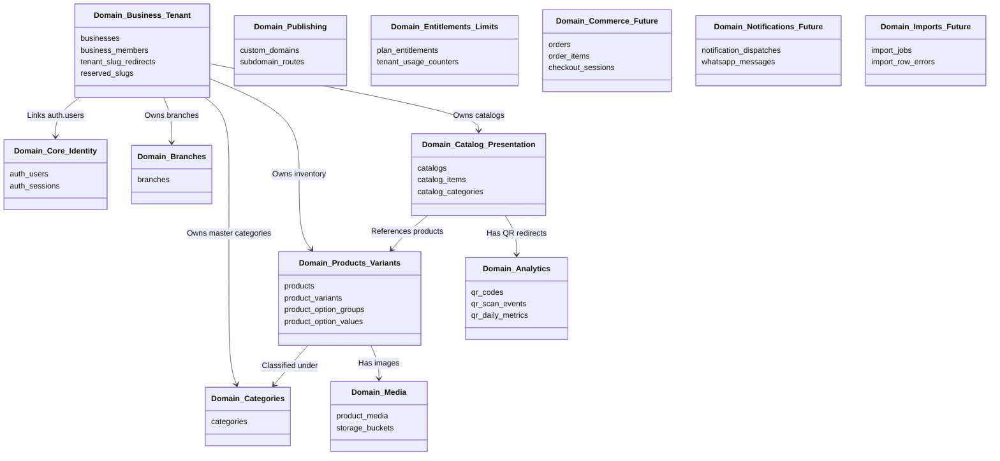
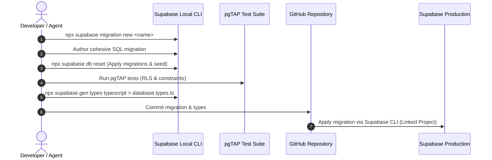

# Database Architecture & Migration Governance

**Project**: Digital Menu & Dynamic QR Platform (`Digital-Catalog`)  
**Database**: Supabase PostgreSQL (`opgiyqxsthrxzrbgupso`)  
**Schema Architecture**: Single-Schema (`public`), Multi-Tenant Shared Database  
**Document Status**: Approved Architecture & Governance Standard  
**Date**: 2026-11-06  

---

## 1. Current Database Architecture Assessment

### 1.1 Existing State Summary
- **Database Engine**: PostgreSQL 15+ hosted on Supabase Cloud Free Tier (500MB DB limit).
- **PostgreSQL Schema**: Single schema `public`.
- **Primary Tenant Key**: `business_id` (UUID referencing `businesses.id`).
- **Access Pattern**: Stateless PostgREST queries over HTTPS via Supabase JS client on Cloudflare Workers edge runtime (zero connection pool exhaustion).
- **Current Tables in `public`**:
  1. `businesses`: Tenant entity with `id`, `name`, `slug`, `industry_type`, `currency_code`, `phone_number`, `plan_code`, `max_products`, `max_categories`.
  2. `business_members`: RBAC mapping `auth.users(id)` to `businesses(id)` with roles (`owner`, `admin`, `editor`, `viewer`).
  3. `branches`: Physical locations (`id`, `business_id`, `name`, `is_default`, `address`).
  4. `categories`: Master product categories (`id`, `business_id`, `name` JSONB, `sort_order`, `is_active`).
  5. `products`: Master inventory items (`id`, `business_id`, `category_id`, `name` JSONB, `description` JSONB, `base_price`, `compare_at_price`, `status`, `attributes`).
  6. `product_variants`: Sellable variations (`id`, `product_id`, `name` JSONB, `price`, `compare_at_price`, `is_available`).
  7. `product_option_groups`: Modifier groups (`id`, `product_id`, `name` JSONB, `is_required`, `min_selections`, `max_selections`).
  8. `product_option_values`: Modifier options (`id`, `group_id`, `name` JSONB, `price_delta`, `is_default`).
  9. `product_media`: Images linked to products (`id`, `product_id`, `storage_path`, `public_url`, `is_cover`, `sort_order`).
  10. `catalogs`: Curated menu presentations (`id`, `business_id`, `name`, `slug`, `is_published`, `theme_config`).
  11. `catalog_items`: Products placed in a catalog with overrides (`id`, `catalog_id`, `product_id`, `category_id`, `price_override`, `sort_order`, `is_available`).
  12. `qr_codes`: Dynamic permanent QR records (`id`, `business_id`, `catalog_id`, `short_code`, `is_active`, `total_scans`).
  13. `qr_scan_events`: Asynchronous scan log (`id`, `qr_id`, `timestamp`, `visitor_hash`, `device_type`, `country_code`).
  14. `qr_daily_metrics`: Daily aggregated analytics (`id`, `qr_id`, `date`, `total_scans`, `unique_visitors`).

### 1.2 Assessment & Critical Gaps in Previous Workflow
- **Monolithic Schema Contract**: Previous migrations were recorded in a single 415-line SQL file (`specs/001-core-catalog-platform/contracts/database-schema.sql`).
- **Absence of Versioned Migration Files**: The `supabase/migrations/` directory was unpopulated in Git. Changes were applied imperatively through Supabase dashboard or SQL editor, creating drift risk between environments.
- **Untracked Rollbacks & Down-Scripts**: No standardized rollback documentation existed for previously applied changes.
- **Missing TypeScript Type Generation**: TypeScript interfaces were hand-maintained in `src/shared/types.ts` rather than generated automatically from PostgreSQL database introspection (`supabase gen types typescript`).
- **No Explicit Migration Review Process**: Changes lacked a formal database impact review gate.

---

## 2. Logical Domain Ownership Map

To maintain a clean, modular, and maintainable architecture without the complexity of multiple PostgreSQL schemas, all tables reside in the standard `public` schema but are categorized into **13 Logical Domains**:



### Table to Domain Assignment Matrix

| Logical Domain | Domain Code | Tables Assigned | Ownership & Boundaries |
| :--- | :--- | :--- | :--- |
| **1. Core & Identity** | `core` | `auth.users` (Supabase managed) | Authentication identity, user profiles, MFA state. |
| **2. Business & Tenant** | `tenant` | `businesses`, `business_members`, `reserved_slugs`, `tenant_slug_redirects` | Merchant profile, business slug, multi-tenant RBAC mapping, DNS name validation. |
| **3. Branches** | `branch` | `branches` | Physical store branches, locations, default store pickup details. |
| **4. Categories** | `category`| `categories` | Master business category taxonomy (ar/en JSONB), sorting orders. |
| **5. Products & Variants** | `product` | `products`, `product_variants`, `product_option_groups`, `product_option_values` | Master inventory items, SKU variations, modifier groups, and addon choices. |
| **6. Media** | `media` | `product_media`, Supabase Storage (`product-images`) | Compressed WebP product photos, storage paths, cover flags, sort orders. |
| **7. Catalog Management** | `catalog` | `catalogs`, `catalog_items` | Presentation menus, theme configs, curated product placement, price overrides. |
| **8. Publishing** | `publish` | `catalogs.is_published`, (future `custom_domains`) | Live menu accessibility, public availability toggles, domain mapping records. |
| **9. Analytics** | `analytics`| `qr_codes`, `qr_scan_events`, `qr_daily_metrics` | Dynamic 302 QR codes, privacy-safe salted scan logs, daily scan aggregations. |
| **10. Entitlements & Limits** | `limits` | `businesses.plan_code`, `max_products`, `max_categories` | Free tier quota enforcement, storage limits, product counters. |
| **11. Commerce (Future)** | `commerce` | Future: `orders`, `order_items`, `cart_sessions` | Customer orders, cart checkout, order status lifecycle. |
| **12. Notifications (Future)**| `notify` | Future: `notification_logs`, `whatsapp_dispatches` | WhatsApp order notifications, merchant SMS/email alerts. |
| **13. Imports (Future)** | `import` | Future: `import_jobs`, `import_errors` | CSV / Excel bulk product uploads, background ingestion. |

---

## 3. Migration Naming Convention

All migrations must be compatible with the Supabase CLI (`npx supabase db push` / `npx supabase migration new`) and follow this strict standard:

```text
supabase/migrations/<YYYYMMDDHHMMSS>_<domain>_<feature_or_action>.sql
```

### Format Specification
1. **Timestamp (`YYYYMMDDHHMMSS`)**: 14-digit UTC timestamp (auto-generated by `supabase migration new` or explicitly ordered).
2. **Domain Code (`<domain>`)**: Matches one of the 13 logical domain codes (`core`, `tenant`, `branch`, `category`, `product`, `media`, `catalog`, `publish`, `analytics`, `limits`, `commerce`, `notify`, `import`).
3. **Feature or Action (`<feature_or_action>`)**: 2–4 hyphen/underscore-delimited words describing the change with action-first phrasing.

### Valid Examples
- `20261105190000_core_tenant_initial_schema.sql` (Initial core MVP)
- `20261106160000_tenant_status_and_dns_constraints.sql` (Subdomain status & regex constraints)
- `20261106160500_tenant_reserved_slugs_registry.sql` (Reserved slugs table and seed)
- `20261106161000_tenant_slug_validation_functions.sql` (Stored procedures for slug checks)
- `20261107120000_product_allergen_attributes_schema.sql` (Product domain enhancement)

---

## 4. Recommended Directory Structure

```text
E:\Projects\Digital-Catalog\
├── docs/
│   └── database/
│       ├── governance.md               <-- This Document
│       ├── domain-map.md               <-- Detailed Logical Domain Map
│       ├── data-dictionary.md          <-- Complete Column-by-Column Schema Dictionary
│       └── erd.md                      <-- Global Mermaid Entity Relationship Diagram
├── supabase/
│   ├── migrations/
│   │   ├── 20261105190000_core_tenant_initial_schema.sql
│   │   ├── 20261106160000_tenant_status_and_dns_constraints.sql
│   │   ├── 20261106160500_tenant_reserved_slugs_registry.sql
│   │   ├── 20261106161000_tenant_slug_validation_functions.sql
│   │   └── 20261106161500_tenant_slug_redirects.sql
│   ├── tests/
│   │   └── database/                   <-- pgTAP / SQL tests
│   │       ├── 01_tenant_isolation.sql
│   │       └── 02_slug_validation.sql
│   ├── seed.sql                        <-- Development seed data ONLY (Never in migrations)
│   └── config.toml                     <-- Supabase local config
├── src/
│   └── shared/
│       └── database.types.ts           <-- Auto-generated Supabase TypeScript types
```

---

## 5. Migration Governance Rules (NON-NEGOTIABLE)

### Rule 1: Single Source of Truth
`supabase/migrations/*.sql` is the **exclusive, unbypassable source of truth** for all database structure, functions, triggers, and RLS policies. Direct modifications via the Supabase Web Dashboard SQL editor are strictly barred in production.

### Rule 2: Absolute Immutability
Once a migration has been committed to `main` or applied to any shared environment (staging or production), it is **immutable**. It must never be edited, deleted, or renamed. Any corrections or schema changes must be introduced via a new subsequent timestamped migration.

### Rule 3: Cohesive Grouping & Sizing
- **No Monolithic Catch-Alls**: Do not combine unrelated domains (e.g. products, QR analytics, and payment billing) in one migration file.
- **No Trivial One-Liners**: Do not create a separate migration for adding a single nullable column unless it represents an independent feature release. Group logically coherent changes into domain-focused files.

### Rule 4: Zero Table Locks & Safe DDL (Postgres Best Practices)
All migrations must comply with the `supabase-postgres-best-practices` guidelines:
- **Index Creation**: Use `CREATE INDEX CONCURRENTLY` in standalone transactions where supported, or ensure queries are optimized to avoid long access exclusive locks.
- **Adding Columns with Defaults**: In PostgreSQL 11+, adding columns with constant defaults is an instant metadata-only update (no table rewrite). Avoid non-immutable function defaults without careful locking review.
- **Foreign Key Indexing**: Every foreign key column (`business_id`, `product_id`, `category_id`, `catalog_id`) MUST have an accompanying index to prevent sequential scans during cascading deletes and join operations.
- **Function Search Path**: Every function must explicitly specify `SET search_path = public` to prevent search path injection attacks.

### Rule 5: Development Seeds vs. Production Migrations
- `supabase/migrations/`: Contains DDL, functions, constraints, triggers, and immutable lookup data (e.g., `reserved_slugs`).
- `supabase/seed.sql`: Contains test merchants, sample products, dummy menus, and development auth mocks. Seeds must **NEVER** be committed into migration files.

---

## 6. Security, Multi-Tenancy & Row Level Security (RLS) Standards

### 6.1 Multi-Tenant Tenancy Model
Every tenant-scoped table MUST include `business_id UUID NOT NULL REFERENCES public.businesses(id) ON DELETE CASCADE`.

### 6.2 Mandatory RLS on Every Table
Every table created in the `public` schema must execute:
```sql
ALTER TABLE public.<table_name> ENABLE ROW LEVEL SECURITY;
```

### 6.3 Standard 4-Tier Access Matrix

| Role / Context | Authentication | Allowed Operations | RLS Evaluation Standard |
| :--- | :--- | :--- | :--- |
| **Public Visitor (Anon)** | Anonymous (`anon` key) | `SELECT` only | Restricted to published entities: `is_published = true`, `status = 'active'`. |
| **Merchant Owner/Member** | Authenticated (`authenticated`) | `SELECT, INSERT, UPDATE, DELETE` | Verified through `business_members`: `business_id IN (SELECT business_id FROM business_members WHERE user_id = auth.uid())`. |
| **System Background Job** | Service Role (`service_role`) | All operations | Bypasses RLS strictly in isolated GitHub Actions / administrative scripts. |
| **Cross-Tenant Access** | Any role | **DENIED** | Zero rows visible across different `business_id` tenants. |

### 6.4 Optimized RLS Helper Function
To eliminate repetitive subqueries in RLS policies and optimize PostgreSQL execution plan caching, use an efficient SECURITY DEFINER function:

```sql
CREATE OR REPLACE FUNCTION public.user_has_business_role(p_business_id UUID, p_roles TEXT[])
RETURNS BOOLEAN
LANGUAGE sql
STABLE
SECURITY DEFINER
SET search_path = public
AS $$
  SELECT EXISTS (
    SELECT 1 FROM public.business_members
    WHERE business_id = p_business_id
      AND user_id = auth.uid()
      AND role = ANY(p_roles)
  );
$$;
```

---

## 7. Documentation & Tooling Standards

### 7.1 Automated TypeScript Type Generation
Whenever a migration is created or applied, the platform TypeScript definitions MUST be regenerated:

```bash
npx supabase gen types typescript --project-id opgiyqxsthrxzrbgupso > src/shared/database.types.ts
```

This guarantees 100% end-to-end type safety across TanStack Start server functions, route loaders, and client state.

### 7.2 Migration Verification Workflow



---

## 8. Spec Kit Integration: Mandatory "Database Impact" Section

Every feature specification (`spec.md`) and implementation plan (`plan.md`) produced by Specify MUST include the following standardized **Database Impact** section:

```markdown
### Database Impact
- **Logical Domain**: [One of the 13 domains, e.g., `tenant`, `product`, `catalog`]
- **Existing Tables Affected**: [Tables modified or referenced]
- **New Tables**: [Tables created]
- **Columns & Data Types**: [Exact column types, nullability, defaults]
- **Primary & Foreign Keys**: [Constraints and cascading rules]
- **Unique & Check Constraints**: [RFC 1123, lowercase indexes, enum values]
- **Indexes**: [Composite and partial indexes for query performance]
- **RLS Policies**: [Anon, Authenticated, and Member access definitions]
- **Functions & Triggers**: [PL/pgSQL functions with `search_path = public`]
- **Migration Files**: [Exact timestamped migration filenames]
- **Data Migration Requirements**: [Data transformations, backfills, or locks]
- **Rollback Strategy**: [Exact down-SQL or safe reversion steps]
- **Type Generation**: [Plan to run `supabase gen types typescript`]
```

---

## 9. Migration Plan for Dynamic Tenant Subdomains Feature (`002-dynamic-subdomains`)

Applying the new governance standard to the planned `002-dynamic-subdomains` feature produces the following **4 coherent, ordered migrations**:

### Migration 1: `20261106160000_tenant_status_and_dns_constraints.sql`
- **Domain**: `tenant`
- **Scope**:
  1. Create ENUM `public.business_status` (`'active'`, `'suspended'`, `'archived'`).
  2. Add `status` column to `public.businesses` (`NOT NULL DEFAULT 'active'`).
  3. Create unique index `idx_businesses_slug_lower_unique` on `public.businesses (LOWER(slug))`.
  4. Add CHECK constraint `chk_business_slug_dns_format` enforcing RFC 1123 DNS label syntax.

### Migration 2: `20261106160500_tenant_reserved_slugs_registry.sql`
- **Domain**: `tenant`
- **Scope**:
  1. Create table `public.reserved_slugs` (`id`, `slug`, `category`, `reason`, `created_at`).
  2. Create unique index `idx_reserved_slugs_lower` on `LOWER(slug)`.
  3. Seed initial 35+ reserved system, infrastructure (`www`, `tools`, `digitalmenu`), protocol, and security keywords.
  4. Enable RLS: `SELECT` for public/authenticated, write denied.

### Migration 3: `20261106161000_tenant_slug_validation_functions.sql`
- **Domain**: `tenant`
- **Scope**:
  1. Create function `public.is_slug_available(p_slug TEXT) RETURNS BOOLEAN` with atomic validation against format, reserved list, and existing businesses.
  2. Update `public.create_merchant_business` atomic RPC to invoke `is_slug_available` and register valid tenant subdomains.

### Migration 4: `20261106161500_tenant_slug_redirects.sql`
- **Domain**: `tenant`
- **Scope**:
  1. Create table `public.tenant_slug_redirects` (`id`, `business_id`, `old_slug`, `new_slug`, `created_at`).
  2. Create index on `LOWER(old_slug)` for instant 301 redirect resolution when a merchant slug is renamed.
  3. Enable RLS and foreign key constraints.

