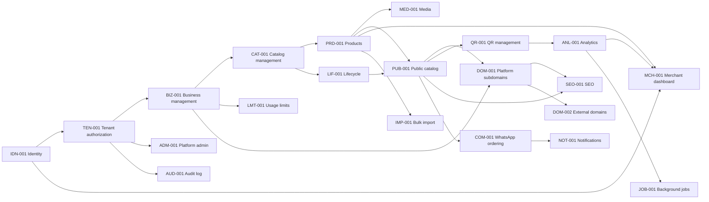

# Feature Dependencies and Delivery Order

## Dependency Map

## Recommended Documentation and Delivery Sequence

1. Confirm identity, authorization, business ownership, catalog, product, and lifecycle contracts.
2. Verify the public catalog, QR, and existing platform-subdomain behavior against those contracts.
3. Define analytics, SEO, and merchant-dashboard gaps.
4. Complete the WhatsApp cart specification before creating its plan.
5. Defer administration, notifications, audit logs, background jobs, import, and external domains until their prerequisite contracts are stable.

## Safe Parallel Work

- Media and usage-limit specifications can be refined after product and business ownership are agreed.
- SEO can be refined alongside public-catalog verification once the canonical merchant URL is fixed.
- Merchant-dashboard documentation can proceed alongside public-catalog documentation because it consumes established feature contracts.
- Future-feature boundary drafts can be reviewed independently. They must not create implementation plans before their dependencies are approved.
