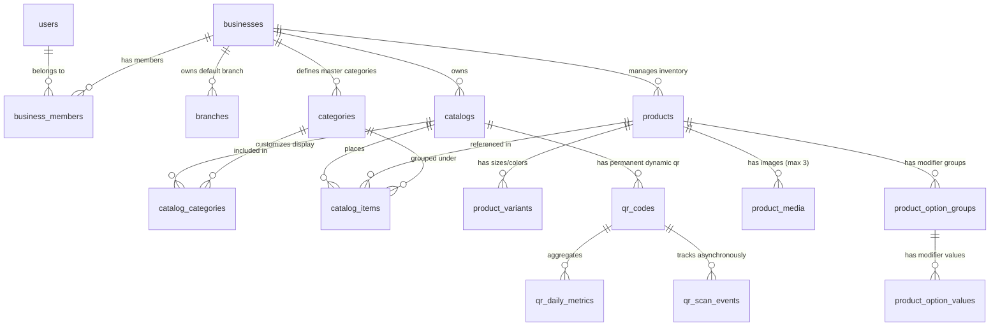

# Database Data Model: Core Digital Catalog & QR Platform

**Feature**: `001-core-catalog-platform` | **Date**: 2026-11-05

---

## 1. Entity Relationship Diagram (ERD)



---

## 2. Table Specifications & Constraints

### 2.1 `businesses` (Tenants)
Represents the merchant's business entity.
- `id` (UUID, Primary Key, `gen_random_uuid()`)
- `name` (TEXT, NOT NULL)
- `slug` (TEXT, UNIQUE, NOT NULL) — e.g., `alfanoos-restaurant`
- `industry_type` (TEXT, NOT NULL, DEFAULT `'restaurant'`) — `restaurant`, `grocery`, `fashion`, `services`
- `currency_code` (VARCHAR(3), NOT NULL, DEFAULT `'SAR'`)
- `phone_number` (TEXT, NULL) — International format for WhatsApp ordering
- `logo_url` (TEXT, NULL)
- `cover_url` (TEXT, NULL)
- `plan_code` (TEXT, NOT NULL, DEFAULT `'free'`)
- `max_products` (INT, NOT NULL, DEFAULT 100)
- `max_categories` (INT, NOT NULL, DEFAULT 15)
- `created_at` (TIMESTAMPTZ, NOT NULL, DEFAULT `NOW()`)
- `updated_at` (TIMESTAMPTZ, NOT NULL, DEFAULT `NOW()`)

### 2.2 `business_members` (RBAC)
Maps Supabase authenticated users (`auth.users`) to businesses.
- `id` (UUID, Primary Key, `gen_random_uuid()`)
- `business_id` (UUID, NOT NULL, REFERENCES `businesses(id)` ON DELETE CASCADE)
- `user_id` (UUID, NOT NULL) — Foreign key to `auth.users(id)`
- `role` (TEXT, NOT NULL, DEFAULT `'owner'`) — `owner`, `admin`, `editor`, `viewer`
- `created_at` (TIMESTAMPTZ, NOT NULL, DEFAULT `NOW()`)
- **Constraints**: `UNIQUE(business_id, user_id)`

### 2.3 `branches`
Physical store locations. In MVP, exactly one default branch is auto-created.
- `id` (UUID, Primary Key, `gen_random_uuid()`)
- `business_id` (UUID, NOT NULL, REFERENCES `businesses(id)` ON DELETE CASCADE)
- `name` (TEXT, NOT NULL, DEFAULT `'الفرع الرئيسي'`)
- `is_default` (BOOLEAN, NOT NULL, DEFAULT `true`)
- `address` (TEXT, NULL)
- `created_at` (TIMESTAMPTZ, NOT NULL, DEFAULT `NOW()`)

### 2.4 `categories` (Master Taxonomies)
Master categories owned by the business.
- `id` (UUID, Primary Key, `gen_random_uuid()`)
- `business_id` (UUID, NOT NULL, REFERENCES `businesses(id)` ON DELETE CASCADE)
- `name` (JSONB, NOT NULL) — `{ "ar": "المشويات", "en": "Grills" }`
- `sort_order` (INT, NOT NULL, DEFAULT 0)
- `is_active` (BOOLEAN, NOT NULL, DEFAULT `true`)
- `created_at` (TIMESTAMPTZ, NOT NULL, DEFAULT `NOW()`)
- **Indexes**: `INDEX idx_categories_business (business_id, sort_order)`

### 2.5 `products` (Master Inventory)
Canonical master products owned by the business.
- `id` (UUID, Primary Key, `gen_random_uuid()`)
- `business_id` (UUID, NOT NULL, REFERENCES `businesses(id)` ON DELETE CASCADE)
- `category_id` (UUID, NOT NULL, REFERENCES `categories(id)` ON DELETE RESTRICT)
- `name` (JSONB, NOT NULL) — `{ "ar": "كباب حلبي", "en": "Halabi Kebab" }`
- `description` (JSONB, NULL) — `{ "ar": "وجبة مشويات طازجة", "en": "Fresh grilled meat" }`
- `base_price` (NUMERIC(12, 2), NULL) — Base price if product has no required variant selection
- `compare_at_price` (NUMERIC(12, 2), NULL) — Strikethrough price for promotions
- `barcode` (TEXT, NULL) — EAN/UPC for supermarkets
- `sku` (TEXT, NULL) — Inventory SKU code
- `unit` (TEXT, NULL) — `piece`, `kg`, `g`, `pack`
- `status` (TEXT, NOT NULL, DEFAULT `'active'`) — `active`, `out_of_stock`, `archived`
- `attributes` (JSONB, NOT NULL, DEFAULT `'{}'::jsonb`) — Industry-specific typed attributes (calories, allergens, size chart)
- `created_at` (TIMESTAMPTZ, NOT NULL, DEFAULT `NOW()`)
- `updated_at` (TIMESTAMPTZ, NOT NULL, DEFAULT `NOW()`)
- **Indexes**:
  - `INDEX idx_products_business_status (business_id, status)`
  - `INDEX idx_products_barcode (business_id, barcode) WHERE barcode IS NOT NULL`

### 2.6 `product_variants` (SKU Variations)
Sellable variations with specific prices (e.g. Sizes, Colors).
- `id` (UUID, Primary Key, `gen_random_uuid()`)
- `product_id` (UUID, NOT NULL, REFERENCES `products(id)` ON DELETE CASCADE)
- `name` (JSONB, NOT NULL) — `{ "ar": "كبير", "en": "Large" }`
- `sku` (TEXT, NULL)
- `barcode` (TEXT, NULL)
- `price` (NUMERIC(12, 2), NOT NULL) — Exact price for this specific variant
- `compare_at_price` (NUMERIC(12, 2), NULL)
- `is_available` (BOOLEAN, NOT NULL, DEFAULT `true`)
- `attributes` (JSONB, NOT NULL, DEFAULT `'{}'::jsonb`) — `{ "size": "L", "color": "Blue" }`
- `sort_order` (INT, NOT NULL, DEFAULT 0)

### 2.7 `product_option_groups` (Modifier Groups)
Customization groups linked to a product (e.g., "Add-ons", "Cooking Level").
- `id` (UUID, Primary Key, `gen_random_uuid()`)
- `product_id` (UUID, NOT NULL, REFERENCES `products(id)` ON DELETE CASCADE)
- `name` (JSONB, NOT NULL) — `{ "ar": "الإضافات", "en": "Extra Toppings" }`
- `is_required` (BOOLEAN, NOT NULL, DEFAULT `false`)
- `min_selections` (INT, NOT NULL, DEFAULT 0)
- `max_selections` (INT, NOT NULL, DEFAULT 1)
- `sort_order` (INT, NOT NULL, DEFAULT 0)

### 2.8 `product_option_values` (Modifier Choices)
Individual choices within an option group.
- `id` (UUID, Primary Key, `gen_random_uuid()`)
- `group_id` (UUID, NOT NULL, REFERENCES `product_option_groups(id)` ON DELETE CASCADE)
- `name` (JSONB, NOT NULL) — `{ "ar": "جبنة إضافية", "en": "Extra Cheese" }`
- `price_delta` (NUMERIC(12, 2), NOT NULL, DEFAULT 0.00) — Added to base/variant price
- `is_default` (BOOLEAN, NOT NULL, DEFAULT `false`)
- `sort_order` (INT, NOT NULL, DEFAULT 0)

### 2.9 `product_media` (Image Assets)
Compressed WebP images for products (max 3 per product).
- `id` (UUID, Primary Key, `gen_random_uuid()`)
- `product_id` (UUID, NOT NULL, REFERENCES `products(id)` ON DELETE CASCADE)
- `storage_path` (TEXT, NOT NULL) — Path inside Supabase Storage bucket
- `public_url` (TEXT, NOT NULL)
- `file_size_bytes` (INT, NOT NULL)
- `is_cover` (BOOLEAN, NOT NULL, DEFAULT `false`)
- `sort_order` (INT, NOT NULL, DEFAULT 0)
- `created_at` (TIMESTAMPTZ, NOT NULL, DEFAULT `NOW()`)

### 2.10 `catalogs` (Curated Presentations)
Published catalogs belonging to the business (1 catalog in Free Plan).
- `id` (UUID, Primary Key, `gen_random_uuid()`)
- `business_id` (UUID, NOT NULL, REFERENCES `businesses(id)` ON DELETE CASCADE)
- `name` (TEXT, NOT NULL)
- `slug` (TEXT, NOT NULL) — e.g. `main-menu`
- `is_published` (BOOLEAN, NOT NULL, DEFAULT `true`)
- `theme_config` (JSONB, NOT NULL, DEFAULT `'{}'::jsonb`)
- `created_at` (TIMESTAMPTZ, NOT NULL, DEFAULT `NOW()`)
- **Constraints**: `UNIQUE(business_id, slug)`

### 2.11 `catalog_items` (Catalog Placements)
Decoupled placement of a product inside a catalog with overrides.
- `id` (UUID, Primary Key, `gen_random_uuid()`)
- `catalog_id` (UUID, NOT NULL, REFERENCES `catalogs(id)` ON DELETE CASCADE)
- `product_id` (UUID, NOT NULL, REFERENCES `products(id)` ON DELETE CASCADE)
- `category_id` (UUID, NOT NULL, REFERENCES `categories(id)` ON DELETE RESTRICT)
- `price_override` (NUMERIC(12, 2), NULL) — Overrides base product price if set
- `sort_order` (INT, NOT NULL, DEFAULT 0)
- `is_featured` (BOOLEAN, NOT NULL, DEFAULT `false`)
- `is_available` (BOOLEAN, NOT NULL, DEFAULT `true`)
- **Constraints**: `UNIQUE(catalog_id, product_id)`

### 2.12 `qr_codes` (Permanent Dynamic Redirects)
Stable QR codes pointing to `/q/:shortCode`.
- `id` (UUID, Primary Key, `gen_random_uuid()`)
- `business_id` (UUID, NOT NULL, REFERENCES `businesses(id)` ON DELETE CASCADE)
- `catalog_id` (UUID, NOT NULL, REFERENCES `catalogs(id)` ON DELETE CASCADE)
- `short_code` (VARCHAR(16), UNIQUE, NOT NULL) — e.g., `x7b9q2`
- `is_active` (BOOLEAN, NOT NULL, DEFAULT `true`)
- `total_scans` (BIGINT, NOT NULL, DEFAULT 0)
- `created_at` (TIMESTAMPTZ, NOT NULL, DEFAULT `NOW()`)
- **Indexes**: `INDEX idx_qr_codes_short_code (short_code)`

### 2.13 `qr_scan_events` & `qr_daily_metrics` (Analytics)
- `qr_scan_events`: Ephemeral log (purged after 30 days) containing `(id, qr_code_id, timestamp, fingerprint_hash, is_bot, referrer)`.
- `qr_daily_metrics`: Permanent daily rollups `(qr_code_id, date, total_scans, unique_visitors, bot_scans)`.

---

## 3. Row Level Security (RLS) Policies

All tables have RLS enabled: `ALTER TABLE <table_name> ENABLE ROW LEVEL SECURITY;`.

### Policy Pattern: Tenant-Isolated Private Access
```sql
-- Security Definer helper to retrieve the user's active business IDs
CREATE OR REPLACE FUNCTION get_user_business_ids()
RETURNS SETOF UUID AS $$
  SELECT business_id FROM business_members WHERE user_id = auth.uid();
$$ LANGUAGE sql SECURITY DEFINER STABLE;

-- Example policy for products table
CREATE POLICY "Merchant members can view their own products"
  ON products FOR SELECT
  USING (business_id IN (SELECT get_user_business_ids()));

CREATE POLICY "Merchant members can insert products in their business"
  ON products FOR INSERT
  WITH CHECK (business_id IN (SELECT get_user_business_ids()));

CREATE POLICY "Merchant members can update their own products"
  ON products FOR UPDATE
  USING (business_id IN (SELECT get_user_business_ids()))
  WITH CHECK (business_id IN (SELECT get_user_business_ids()));

CREATE POLICY "Merchant members can delete their own products"
  ON products FOR DELETE
  USING (business_id IN (SELECT get_user_business_ids()));
```

### Policy Pattern: Public Catalog Read-Only Access
Public customers do not log in. They read published catalogs through explicit public-scoped read policies:
```sql
CREATE POLICY "Public can view published catalogs"
  ON catalogs FOR SELECT
  USING (is_published = true);

CREATE POLICY "Public can view active products in published catalogs"
  ON products FOR SELECT
  USING (
    status = 'active' AND 
    id IN (
      SELECT product_id FROM catalog_items ci
      JOIN catalogs c ON c.id = ci.catalog_id
      WHERE c.is_published = true AND ci.is_available = true
    )
  );

CREATE POLICY "Public can resolve active QR codes"
  ON qr_codes FOR SELECT
  USING (is_active = true);
```

---

## 4. Atomic PostgreSQL Quota Trigger

Enforces the 100-product ceiling with row-level serialization (`FOR UPDATE`) to defeat race conditions:

```sql
CREATE OR REPLACE FUNCTION enforce_product_quota()
RETURNS TRIGGER AS $$
DECLARE
  v_current_count INT;
  v_max_limit INT;
BEGIN
  -- Row-level exclusive lock on the business tenant record
  SELECT max_products INTO v_max_limit
  FROM businesses
  WHERE id = NEW.business_id
  FOR UPDATE;

  SELECT COUNT(*) INTO v_current_count
  FROM products
  WHERE business_id = NEW.business_id
    AND status != 'archived';

  IF v_current_count >= v_max_limit THEN
    RAISE EXCEPTION 'Product quota exceeded: Maximum % products permitted on current plan.', v_max_limit
      USING ERRCODE = 'check_violation';
  END IF;

  RETURN NEW;
END;
$$ LANGUAGE plpgsql;

CREATE TRIGGER trg_enforce_product_quota
BEFORE INSERT ON products
FOR EACH ROW
EXECUTE FUNCTION enforce_product_quota();
```

