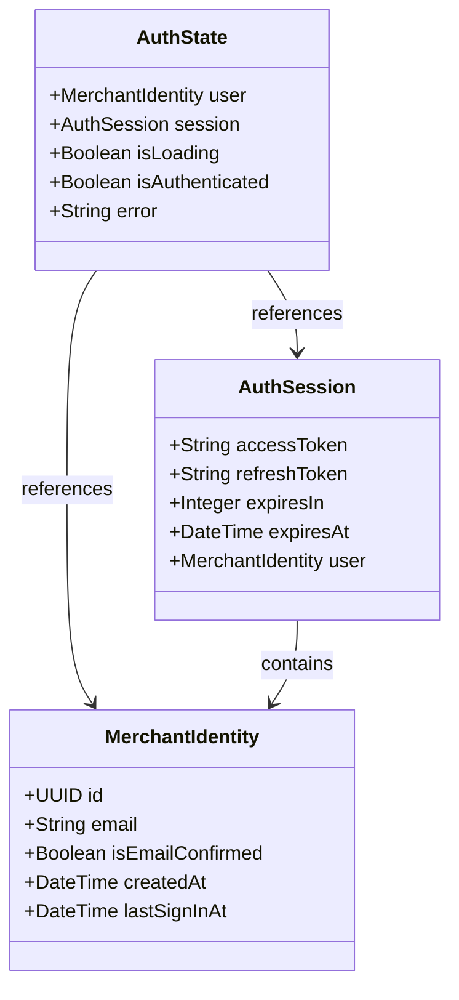
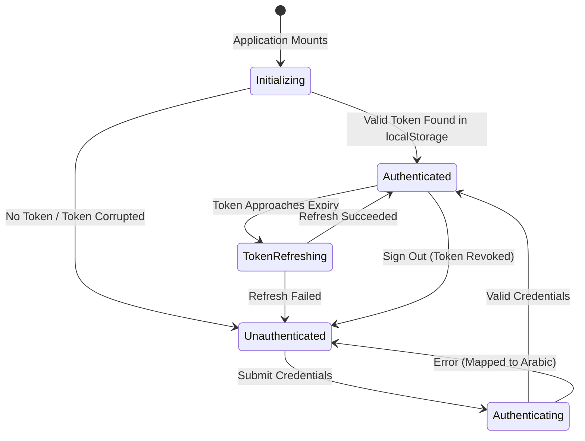

# Data Model: Identity and Access (IDN-001)

**Feature**: `IDN-001: Identity and Access`  
**Date**: 2026-11-06  
**Status**: Completed

## 1. Core Entities



### Entity: `MerchantIdentity`
Represents the verified user record managed natively inside Supabase's `auth.users` schema.

| Field | Type | Description |
|---|---|---|
| `id` | `UUID` (PK) | Globally unique identifier generated by the identity provider. Used across the entire application as `auth.uid()`. |
| `email` | `string` | Normalized lowercase email address. Unique across all platform identities. |
| `isEmailConfirmed` | `boolean` | Flag indicating whether the email verification link was confirmed. |
| `createdAt` | `string` (ISO 8601) | Timestamp of original registration. |
| `lastSignInAt` | `string` (ISO 8601) | Timestamp of the most recent authentication. |

---

### Entity: `AuthSession`
Represents the active client session token bundle.

| Field | Type | Description |
|---|---|---|
| `accessToken` | `string` (JWT) | Signed JSON Web Token containing claims (`sub`, `aud`, `exp`, `email`). Sent with PostgREST calls. |
| `refreshToken` | `string` | Opaque token used to obtain a new access token without re-entering credentials. |
| `expiresIn` | `number` | Lifetime of the access token in seconds (default: 3600s / 1 hour). |
| `expiresAt` | `number` | Unix epoch timestamp when the access token expires. |
| `user` | `MerchantIdentity` | The identity associated with this session. |

---

## 2. Validation Schemas (Zod)

All input data entering the authentication boundary is validated through strict Zod schemas with Arabic error messages.

### Login Input Schema (`loginSchema`)
```typescript
import { z } from 'zod';

export const loginSchema = z.object({
  email: z
    .string('يرجى إدخال البريد الإلكتروني')
    .trim()
    .toLowerCase()
    .email('صيغة البريد الإلكتروني غير صحيحة'),
  password: z
    .string('يرجى إدخال كلمة المرور')
    .min(6, 'كلمة المرور يجب أن تتكون من 6 أحرف على الأقل'),
});

export type LoginInput = z.infer<typeof loginSchema>;
```

### Registration Input Schema (`registerSchema`)
```typescript
export const registerSchema = z
  .object({
    email: z
      .string('يرجى إدخال البريد الإلكتروني')
      .trim()
      .toLowerCase()
      .email('صيغة البريد الإلكتروني غير صحيحة'),
    password: z
      .string('يرجى إدخال كلمة المرور')
      .min(6, 'كلمة المرور يجب أن تتكون من 6 أحرف على الأقل'),
    confirmPassword: z
      .string('يرجى تأكيد كلمة المرور'),
  })
  .refine((data) => data.password === data.confirmPassword, {
    message: 'كلمتا المرور غير متطابقتين',
    path: ['confirmPassword'],
  });

export type RegisterInput = z.infer<typeof registerSchema>;
```

### Password Reset Input Schema (`passwordResetSchema`)
```typescript
export const passwordResetSchema = z.object({
  email: z
    .string('يرجى إدخال البريد الإلكتروني')
    .trim()
    .toLowerCase()
    .email('صيغة البريد الإلكتروني غير صحيحة'),
});

export type PasswordResetInput = z.infer<typeof passwordResetSchema>;
```

---

## 3. Session State Machine



---

## 4. Database & Storage Impact

- **Database Schemas**: Operates exclusively against Supabase Auth (`auth.users`). Zero custom application tables or migrations are introduced in `public` schema for `IDN-001`.
- **Client Storage**: Session tokens persist in browser `localStorage` under the Supabase key `sb-<project-id>-auth-token`.
- **Data Access Boundary**: Access to tenant data is controlled via `auth.uid()`, which is evaluated downstream by `TEN-001` PostgreSQL RLS policies.

