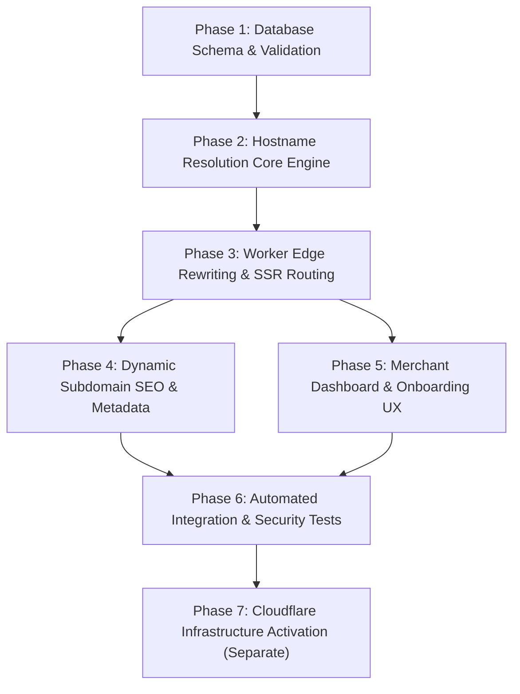

# Implementation Tasks: Multi-Tenant Dynamic Subdomains

**Feature**: `002-dynamic-subdomains` | **Date**: 2026-11-06 | **Status**: Planned (Do Not Execute Yet)

---

## 1. Overview & Execution Protocol

This document defines the atomic, dependency-ordered implementation tasks for the Multi-Tenant Dynamic Subdomain feature.

> [!IMPORTANT]
> **Strict Execution Constraint**: This is a planning and specification artifact. Tasks MUST NOT be executed until formal user approval is granted. Phase 7 (Infrastructure Activation) is completely isolated and must only be executed after Phases 1 through 6 are fully tested.

---

## 2. Dependency Graph

---

## 3. Tasks Breakdown

### Phase 1: Database Schema & Reserved Slugs Registry

- [ ] **T1.1: Create Migration `20261106160000_tenant_status_and_dns_constraints.sql`**
  - **Description**: Prepare the SQL migration script to add `business_status` ENUM, `status` column to `businesses`, RFC 1123 regex constraint on `slug`, and `LOWER(slug)` unique index.
  - **Files**: `supabase/migrations/20261106160000_tenant_status_and_dns_constraints.sql`
  - **Dependencies**: None
  - **Verification**: Verify migration applies cleanly and blocks non-RFC 1123 slugs or duplicate lowercase slugs.

- [ ] **T1.2: Create Migration `20261106160500_tenant_reserved_slugs_registry.sql`**
  - **Description**: Add `reserved_slugs` table and seed with 35+ system, infrastructure (`www`, `tools`, `digitalmenu`), security, and protocol keywords.
  - **Files**: `supabase/migrations/20261106160500_tenant_reserved_slugs_registry.sql`
  - **Dependencies**: T1.1
  - **Verification**: Query `SELECT COUNT(*) FROM reserved_slugs` returns >= 35 rows.

- [ ] **T1.3: Create Migration `20261106161000_tenant_slug_validation_functions.sql`**
  - **Description**: Implement `public.is_slug_available(p_slug TEXT)` function and update `create_merchant_business` atomic RPC to enforce RFC 1123 and reject reserved slugs.
  - **Files**: `supabase/migrations/20261106161000_tenant_slug_validation_functions.sql`
  - **Dependencies**: T1.2
  - **Verification**: Call `SELECT is_slug_available('tools')` → returns `false`; call `SELECT is_slug_available('valid-shop')` → returns `true`.

- [ ] **T1.4: Create Migration `20261106161500_tenant_slug_redirects.sql`**
  - **Description**: Add `tenant_slug_redirects` table to store slug rename history for 301 backward compatibility, with foreign key to `businesses(id)`.
  - **Files**: `supabase/migrations/20261106161500_tenant_slug_redirects.sql`
  - **Dependencies**: T1.1
  - **Verification**: Table created with RLS enabled and lowercase index on `old_slug`.

- [ ] **T1.5: Regenerate Supabase TypeScript Types**
  - **Description**: Run `npx supabase gen types typescript` against the updated schema and save to `src/shared/database.types.ts`.
  - **Files**: `src/shared/database.types.ts`
  - **Dependencies**: T1.1, T1.2, T1.3, T1.4
  - **Verification**: Types file exports definitions for `reserved_slugs`, `tenant_slug_redirects`, and updated `businesses.status`.

---

### Phase 2: Hostname Resolution Core Engine

- [ ] **T2.1: Implement Pure `TenantResolver` Module**
  - **Description**: Create `src/server/tenant/resolver.ts` with edge-safe hostname normalization, base domain scoping, RFC 1123 label extraction, and reserved slugs verification.
  - **Files**: `src/server/tenant/resolver.ts`, `src/server/tenant/reserved-slugs.ts`
  - **Dependencies**: None
  - **Verification**: Unit tests covering 20+ hostname variations (apex, www, tools, valid slug, upper case, trailing dots, dev ports, multi-level subdomains).

- [ ] **T2.2: Unit Tests for Tenant Resolution Engine**
  - **Description**: Write comprehensive unit tests for `TenantResolver` verifying that `tools.daleel-al-suez.com` and `www.daleel-al-suez.com` are recognized as non-tenant infrastructure, and `ahmed-cafe.daleel-al-suez.com` resolves to `ahmed-cafe`.
  - **Files**: `src/server/tenant/__tests__/resolver.test.ts`
  - **Dependencies**: T2.1
  - **Verification**: Run `npm test` or vitest runner; all 20+ tests pass with 100% code coverage.

---

### Phase 3: Cloudflare Worker Edge Integration & Internal URL Rewriting

- [ ] **T3.1: Integrate Tenant Resolver in `entry-worker.ts`**
  - **Description**: Connect `TenantResolver` to `fetch(request, _env, ctx)` in `src/server/entry-worker.ts`.
  - **Files**: `src/server/entry-worker.ts`
  - **Dependencies**: T2.1
  - **Verification**: Verify that requests to `digitalmenu.daleel-al-suez.com` follow existing routes, while tenant subdomains trigger tenant resolution logic.

- [ ] **T3.2: Implement Edge Request Path Rewriter for Subdomain Root**
  - **Description**: For requests matching an active tenant subdomain at root (`/`), internally construct a rewritten request to `/c/:slug` and pass to `fetchHandler(rewrittenRequest)` so that TanStack Start renders the SSR public catalog without a client-side redirect.
  - **Files**: `src/server/entry-worker.ts`
  - **Dependencies**: T3.1
  - **Verification**: Visiting `http://ahmed-cafe.localhost:5173/` renders the catalog HTML at `/` with status 200.

- [ ] **T3.3: Implement Subdomain Security Guardrails (Dashboard & Auth 302 Redirects)**
  - **Description**: If a visitor attempts to access `/dashboard` or `/auth/*` on a tenant subdomain, issue an immediate HTTP 302 redirect to `https://digitalmenu.daleel-al-suez.com/dashboard` or `/auth/*`.
  - **Files**: `src/server/entry-worker.ts`
  - **Dependencies**: T3.2
  - **Verification**: `curl -I http://ahmed-cafe.localhost:5173/dashboard` returns `302 Found` with `Location: https://digitalmenu.daleel-al-suez.com/dashboard`.

- [ ] **T3.4: Implement Dedicated 404 / 403 Tenant Error Pages**
  - **Description**: Create lightweight HTML error responses for unknown merchant subdomains (404), unpublished catalogs (403), and suspended merchants (403) rendered directly from the edge.
  - **Files**: `src/server/tenant/error-pages.ts`, `src/server/entry-worker.ts`
  - **Dependencies**: T3.1
  - **Verification**: Requesting an unknown slug returns HTTP 404 with Arabic "المتجر غير موجود" page.

---

### Phase 4: Dynamic Subdomain SEO, Metadata & Canonical URLs

- [ ] **T4.1: Update Canonical URL Generator in Structured Data Module**
  - **Description**: Update `src/public-catalog/seo/structured-data.ts` to output canonical URLs and OpenGraph URLs using the merchant's dedicated subdomain (`https://<slug>.daleel-al-suez.com/`) instead of the path-based URL.
  - **Files**: `src/public-catalog/seo/structured-data.ts`, `src/routes/_public/c/$catalogSlug.tsx`
  - **Dependencies**: T3.2
  - **Verification**: Inspect generated `<head>` in SSR response; `<link rel="canonical">` matches `https://<slug>.daleel-al-suez.com/`.

- [ ] **T4.2: Add Path-Based to Subdomain 301 Canonical Redirect (Backward Compatibility)**
  - **Description**: When a user accesses `https://digitalmenu.daleel-al-suez.com/c/<slug>`, issue an HTTP 301 Permanent Redirect to `https://<slug>.daleel-al-suez.com/`.
  - **Files**: `src/routes/_public/c/$catalogSlug.tsx`
  - **Dependencies**: T4.1
  - **Verification**: Request to `/c/shaban` on main domain returns `301 Moved Permanently` pointing to `https://shaban.daleel-al-suez.com/`.

---

### Phase 5: Merchant Dashboard & Onboarding UX

- [ ] **T5.1: Real-time Slug Availability Checker in Registration**
  - **Description**: Add debounced validation in `src/routes/auth/register.tsx` and store creation forms calling `is_slug_available(slug)` to give merchants instant visual feedback (green check / red error).
  - **Files**: `src/client/components/forms/SlugInput.tsx`, `src/routes/auth/register.tsx`
  - **Dependencies**: T1.3
  - **Verification**: Typing "tools" shows "هذا الاسم محجوز للنظام"; typing a valid slug shows "الاسم متاح".

- [ ] **T5.2: Display Dedicated Subdomain in Merchant Dashboard & QR Modal**
  - **Description**: Update merchant dashboard overview and QR Download modal to feature their dedicated subdomain `https://<slug>.daleel-al-suez.com/` with a copy-to-clipboard button and external link.
  - **Files**: `src/routes/_admin/dashboard/index.tsx`, `src/client/components/dashboard/QRDownloadModal.tsx`
  - **Dependencies**: T5.1
  - **Verification**: Dashboard displays `https://shaban.daleel-al-suez.com/`; clicking copy copies the clean subdomain.

---

### Phase 6: Automated Integration & Security Tests

- [ ] **T6.1: End-to-End Multi-Tenant Isolation Tests**
  - **Description**: Execute automated tests verifying that Tenant A's products are never visible on Tenant B's subdomain, and that RLS policies prevent data leaks.
  - **Files**: `tests/tenant-isolation.spec.ts`
  - **Dependencies**: T3.2, T4.1
  - **Verification**: Automated test suite passes with 0 failures.

- [ ] **T6.2: Cache Isolation & Hostname Cache Key Verification**
  - **Description**: Verify that Cloudflare Cache-Control headers include proper tags, and requests with different hostnames do not share cache entries.
  - **Files**: `tests/cache-isolation.spec.ts`
  - **Dependencies**: T6.1
  - **Verification**: Response headers include `Cache-Control: public, s-maxage=300`.

---

### Phase 7: (Separate & Isolated) Cloudflare Infrastructure Activation

> [!CAUTION]
> This phase modifies live Cloudflare DNS and Worker Routing. It must only be performed after Phases 1 through 6 are completed and explicitly approved by the platform owner.

- [ ] **T7.1: Pre-Activation Health Checks on Vercel Services**
  - **Description**: Run automated health probes against `daleel-al-suez.com`, `www.daleel-al-suez.com`, and `tools.daleel-al-suez.com` to record baseline latency and HTTP 200 responses.
  - **Verification**: All three Vercel endpoints return HTTP 200.

- [ ] **T7.2: Add Cloudflare Worker Bypass Routes for Vercel Applications**
  - **Description**: In Cloudflare Dashboard > Workers & Pages > Routing Rules:
    1. Add route: `tools.daleel-al-suez.com/*` → Worker: `(none)`.
    2. Add route: `www.daleel-al-suez.com/*` → Worker: `(none)`.
    3. Add route: `daleel-al-suez.com/*` → Worker: `(none)`.
  - **Verification**: Probe Vercel apps again to confirm zero routing interference.

- [ ] **T7.3: Add Cloudflare DNS Wildcard CNAME Record**
  - **Description**: In Cloudflare DNS for `daleel-al-suez.com`, add CNAME record: `*` pointing to `digitalmenu.daleel-al-suez.com` with Proxy status enabled (Orange Cloud).
  - **Verification**: DNS resolution for `test-subdomain.daleel-al-suez.com` resolves to Cloudflare edge IPs.

- [ ] **T7.4: Add Cloudflare Worker Wildcard Route**
  - **Description**: In Cloudflare Worker Routes for `digital-catalog`, add Route: `*.daleel-al-suez.com/*`.
  - **Verification**: Live request to `https://shaban.daleel-al-suez.com/` returns the merchant's digital catalog with valid SSL certificate.

- [ ] **T7.5: Post-Activation Production Smoke Test Suite**
  - **Description**: Verify all production services:
    - `https://daleel-al-suez.com/` → Vercel (200 OK)
    - `https://www.daleel-al-suez.com/` → Vercel (200 OK)
    - `https://tools.daleel-al-suez.com/` → Vercel (200 OK)
    - `https://digitalmenu.daleel-al-suez.com/` → Worker Platform Landing (200 OK)
    - `https://shaban.daleel-al-suez.com/` → Worker Tenant Catalog (200 OK)
    - `https://nonexistent.daleel-al-suez.com/` → Worker 404 Page (404 Not Found)
  - **Verification**: 100% green checks on all 6 targets.

