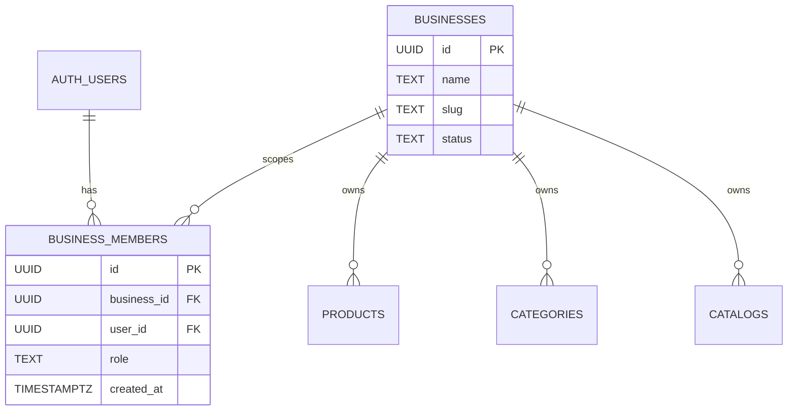
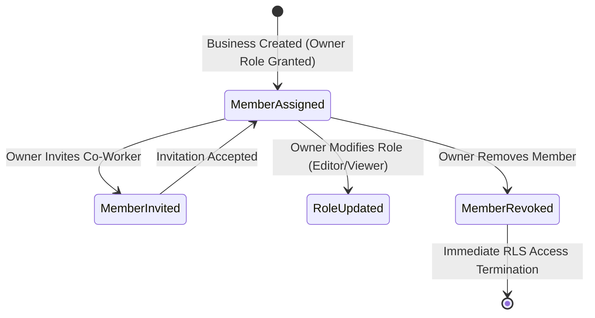

# Data Model: Tenant Authorization (TEN-001)

**Feature**: `TEN-001: Tenant Authorization`  
**Date**: 2026-11-06  
**Status**: Completed

---

## 1. Core Security Entities



### Entity: `BusinessMember` (`public.business_members`)
Associates an authenticated user (`auth.users.id`) with a tenant (`businesses.id`) and assigns their permission role.

| Field | Type | Constraints | Description |
|---|---|---|---|
| `id` | `UUID` | `PRIMARY KEY DEFAULT gen_random_uuid()` | Unique record identifier |
| `business_id` | `UUID` | `NOT NULL REFERENCES businesses(id) ON DELETE CASCADE` | Scoped tenant ID |
| `user_id` | `UUID` | `NOT NULL` (references `auth.users.id`) | Authenticated merchant ID |
| `role` | `TEXT` | `NOT NULL DEFAULT 'owner' CHECK (role IN ('owner', 'admin', 'editor', 'viewer'))` | Permission tier |
| `created_at` | `TIMESTAMPTZ` | `NOT NULL DEFAULT NOW()` | Membership grant timestamp |

**Indexes**:
- `UNIQUE(business_id, user_id)` (prevents duplicate memberships for the same user in a store)
- `INDEX idx_business_members_user ON public.business_members (user_id)`
- `INDEX idx_business_members_lookup ON public.business_members (business_id, user_id, role)`

---

## 2. Security Helper Functions (`SECURITY DEFINER`)

### Function: `public.is_business_member(target_business_id UUID)`
```sql
CREATE OR REPLACE FUNCTION public.is_business_member(target_business_id UUID)
RETURNS BOOLEAN
LANGUAGE sql
STABLE
SECURITY DEFINER
SET search_path = public, auth
AS $$
  SELECT EXISTS (
    SELECT 1 
    FROM public.business_members 
    WHERE business_id = target_business_id 
      AND user_id = (SELECT auth.uid())
  );
$$;
```

### Function: `public.is_business_owner(target_business_id UUID)`
```sql
CREATE OR REPLACE FUNCTION public.is_business_owner(target_business_id UUID)
RETURNS BOOLEAN
LANGUAGE sql
STABLE
SECURITY DEFINER
SET search_path = public, auth
AS $$
  SELECT EXISTS (
    SELECT 1 
    FROM public.business_members 
    WHERE business_id = target_business_id 
      AND user_id = (SELECT auth.uid())
      AND role = 'owner'
  );
$$;
```

---

## 3. RLS Policy Enforcement Matrix

| Domain Table | SELECT Access | INSERT / UPDATE / DELETE Access |
|---|---|---|
| `public.businesses` | `is_business_member(id) OR status = 'active'` | `is_business_owner(id)` |
| `public.business_members` | `user_id = auth.uid() OR is_business_member(business_id)` | `is_business_owner(business_id)` |
| `public.branches` | `is_business_member(business_id) OR true` (read) | `is_business_member(business_id)` (write) |
| `public.categories` | `is_business_member(business_id) OR is_active = true` | `is_business_member(business_id)` |
| `public.products` | `is_business_member(business_id) OR is_available = true` | `is_business_member(business_id)` |
| `public.product_variants` | Inherits product visibility | `is_business_member(business_id)` |
| `public.product_media` | Inherits product visibility | `is_business_member(business_id)` |
| `public.catalogs` | `is_business_member(business_id) OR is_published = true` | `is_business_member(business_id)` |
| `public.catalog_items` | Inherits catalog visibility | `is_business_member(business_id)` |
| `public.qr_codes` | `is_business_member(business_id) OR is_active = true` | `is_business_member(business_id)` |

---

## 4. Tenant Membership State Machine



