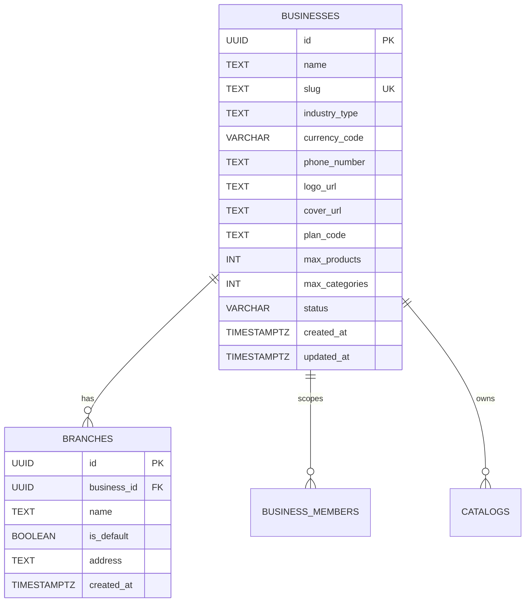

# Data Model: Business & Store Management (BIZ-001)

**Feature**: `BIZ-001: Business and Store Management`  
**Date**: 2026-11-06  
**Status**: Completed

---

## 1. Core Entities



### Entity: `Business` (`public.businesses`)
Represents the central tenant profile.

| Field | Type | Constraints | Description |
|---|---|---|---|
| `id` | `UUID` | `PRIMARY KEY DEFAULT gen_random_uuid()` | Unique tenant identifier |
| `name` | `TEXT` | `NOT NULL` | Public store display name (Arabic/English) |
| `slug` | `TEXT` | `UNIQUE NOT NULL` | DNS label for `{slug}.digitalmenu.daleel-al-suez.com` |
| `industry_type` | `TEXT` | `NOT NULL DEFAULT 'restaurant'` | Category (`restaurant`, `grocery`, `fashion`, `services`) |
| `currency_code` | `VARCHAR(3)` | `NOT NULL DEFAULT 'EGP'` | ISO 3-letter currency |
| `phone_number` | `TEXT` | `NULLABLE` | Primary store contact phone / WhatsApp destination |
| `logo_url` | `TEXT` | `NULLABLE` | URL to store brand logo (WebP) |
| `cover_url` | `TEXT` | `NULLABLE` | URL to store hero cover image (WebP) |
| `plan_code` | `TEXT` | `NOT NULL DEFAULT 'free'` | Active subscription tier |
| `max_products` | `INT` | `NOT NULL DEFAULT 100` | Entitlement limit |
| `max_categories` | `INT` | `NOT NULL DEFAULT 15` | Entitlement limit |
| `status` | `VARCHAR(20)` | `NOT NULL DEFAULT 'active'` | Operational status (`active`, `suspended`, `maintenance`) |
| `created_at` | `TIMESTAMPTZ` | `NOT NULL DEFAULT NOW()` | Creation timestamp |
| `updated_at` | `TIMESTAMPTZ` | `NOT NULL DEFAULT NOW()` | Last update timestamp |

---

### Entity: `Branch` (`public.branches`)
Represents an operational branch of the business. In MVP, exactly one default branch is created.

| Field | Type | Constraints | Description |
|---|---|---|---|
| `id` | `UUID` | `PRIMARY KEY DEFAULT gen_random_uuid()` | Unique branch identifier |
| `business_id` | `UUID` | `NOT NULL REFERENCES businesses(id) ON DELETE CASCADE` | Scoped tenant ID |
| `name` | `TEXT` | `NOT NULL DEFAULT 'الفرع الرئيسي'` | Branch name |
| `is_default` | `BOOLEAN` | `NOT NULL DEFAULT true` | Flag indicating default branch |
| `address` | `TEXT` | `NULLABLE` | Physical street address |
| `created_at` | `TIMESTAMPTZ` | `NOT NULL DEFAULT NOW()` | Creation timestamp |

---

## 2. Validation Schemas (Zod)

### Store Creation Input Schema (`createBusinessSchema`)
```typescript
import { z } from 'zod';

export const SLUG_REGEX = /^[a-z0-9]([a-z0-9-]{1,61}[a-z0-9])?$/;

export const createBusinessSchema = z.object({
  name: z
    .string('يرجى إدخال اسم المتجر')
    .trim()
    .min(2, 'اسم المتجر يجب أن يتكون من حرفين على الأقل')
    .max(100, 'اسم المتجر طويل جداً'),
  slug: z
    .string('يرجى إدخال رابط المتجر')
    .trim()
    .toLowerCase()
    .min(3, 'الرابط قصير جداً (3 أحرف على الأقل)')
    .max(63, 'الرابط طويل جداً (63 حرف كحد أقصى)')
    .refine((val) => !val.includes('--'), {
      message: 'لا يمكن استخدام شرطتين متتاليتين في الرابط',
    })
    .regex(SLUG_REGEX, 'الرابط يجب أن يحتوي على أحرف إنجليزية وأرقام وشرطة واحدة فقط'),
  industryType: z.enum(['restaurant', 'grocery', 'fashion', 'services']).default('restaurant'),
  currencyCode: z.string().default('EGP'),
  phoneNumber: z
    .string()
    .trim()
    .optional()
    .refine((val) => !val || /^[+0-9\s-]{8,20}$/.test(val), {
      message: 'رقم الهاتف غير صالح',
    }),
});

export type CreateBusinessInput = z.infer<typeof createBusinessSchema>;
```

### Store Settings Update Schema (`updateBusinessSchema`)
```typescript
export const updateBusinessSchema = z.object({
  name: z.string().trim().min(2).max(100).optional(),
  phoneNumber: z.string().trim().optional(),
  industryType: z.enum(['restaurant', 'grocery', 'fashion', 'services']).optional(),
  logoUrl: z.string().url().optional().nullable(),
  coverUrl: z.string().url().optional().nullable(),
});

export type UpdateBusinessInput = z.infer<typeof updateBusinessSchema>;
```

