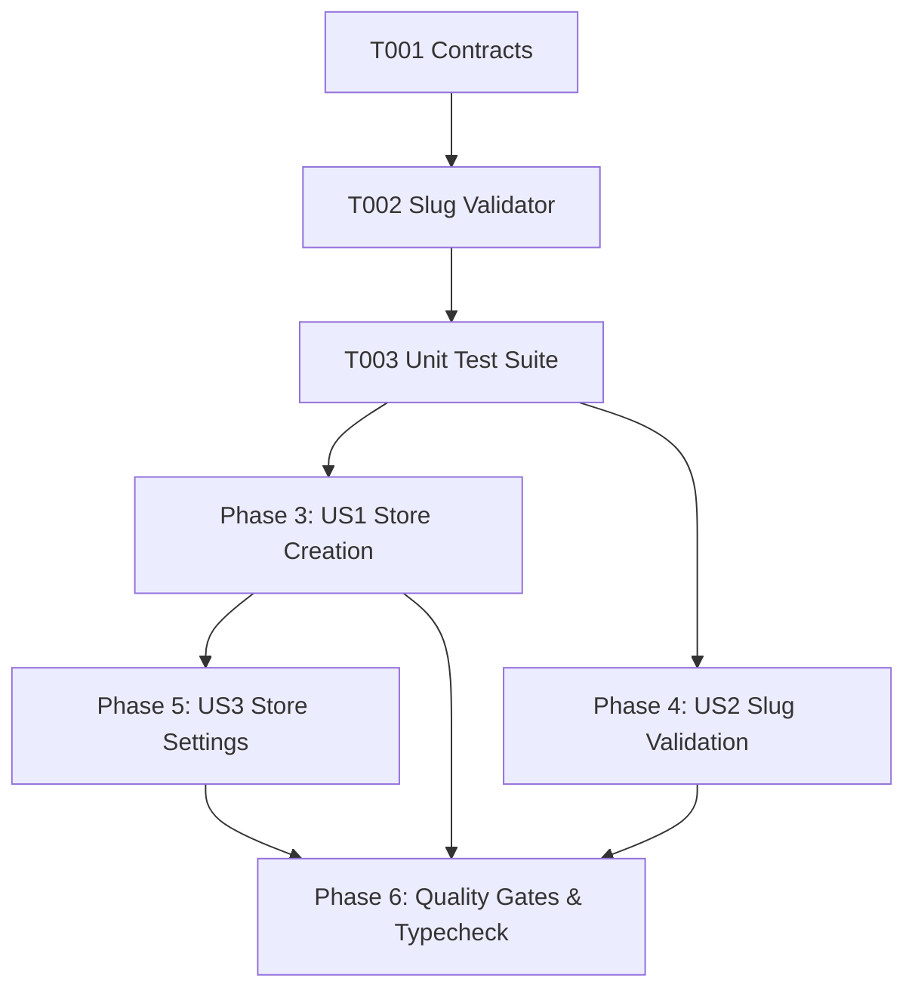

# Tasks: Business and Store Management (BIZ-001)

**Input**: Design documents from `/specs/003-business-store-management/` (`spec.md`, `plan.md`, `research.md`, `data-model.md`, `contracts/business-contracts.ts`, `quickstart.md`)

**Prerequisites**: Approved `spec.md` and `plan.md` (Constitutional Gates: 10/10 Passed)

**Organization**: Grouped by prioritized user stories to enable independent implementation and testable increments.

---

## Phase 1: Setup & Shared Utilities

**Purpose**: Shared validation logic and interface contracts

- [x] T001 [P] Verify `contracts/business-contracts.ts` and `createBusinessSchema` definitions.
- [x] T002 [P] Extract DNS RFC 1123 slug validation utility into `src/client/utils/slug-validator.ts` for clean shared use across client forms and server services.

---

## Phase 2: Foundational Test Harness

**Purpose**: Automated test suite for slug validation, character rules, and store constraints

- [x] T003 [P] Create unit test suite for slug validation in `tests/unit/business-management.test.ts` (testing min/max length, single hyphens, double hyphen rejection, character sets, and reserved words).

**Checkpoint**: Validation utility and unit test harness ready.

---

## Phase 3: User Story 1 - Store Profile Creation & Atomic Provisioning (Priority: P1) 🎯 MVP

**Goal**: Atomically provision business, owner membership, default branch ("الفرع الرئيسي"), and primary catalog upon merchant onboarding.

**Independent Test**: Register a new store via `businessService.createBusiness` and verify all four database entities exist with zero partial/orphan records.

- [x] T004 [US1] Verify atomic multi-table creation in `src/server/services/business.ts` (businesses, business_members, branches, catalogs).
- [x] T005 [US1] Verify default free plan parameters (`plan_code = 'free'`, `max_products = 100`, `max_categories = 15`) assigned to new stores in `src/server/services/business.ts`.
- [x] T006 [US1] Verify compensating rollback in `src/server/services/business.ts` if membership assignment fails.

**Checkpoint**: Store creation and atomic provisioning operational.

---

## Phase 4: User Story 2 - Real-Time DNS-Safe Slug Validation (Priority: P1)

**Goal**: Provide debounced real-time visual feedback on slug availability, formatting, and collision.

**Independent Test**: Enter various slug formats in `/auth/register` and verify accurate real-time badge feedback (too short, double hyphens, reserved, taken, available).

- [x] T007 [US2] Integrate `validateSlugFormat` in `src/routes/auth/register.tsx` for instant format validation before server lookup.
- [x] T008 [US2] Verify collision rejection against existing businesses in `src/server/services/business.ts` (`checkSlugAvailability`).
- [x] T009 [US2] Verify reserved platform slugs rejection (`admin`, `api`, `support`, `billing`, `digitalmenu`) in `src/server/services/business.ts`.

**Checkpoint**: Slug validation and reservation engine operational.

---

## Phase 5: User Story 3 - Business Profile Maintenance & Store Settings (Priority: P2)

**Goal**: Allow store owners to retrieve their business profile and update contact details and branding.

**Independent Test**: Update business name and phone number via `businessService.updateBusiness` and verify changes persist.

- [x] T010 [US3] Implement `updateBusiness` method in `src/server/services/business.ts` allowing store owners to update contact information, logo, and cover.
- [x] T011 [US3] Verify `getBusinessByUserId` in `src/server/services/business.ts` for active dashboard session resolution in `src/routes/_admin.tsx`.

**Checkpoint**: Business profile maintenance and retrieval operational.

---

## Phase 6: Polish, Automated Verification & Quality Gates

**Purpose**: Cross-cutting verification, type safety, and end-to-end testing

- [x] T012 Run automated unit test suite (`node --test tests/unit/*.test.ts`) covering all 4 test suites (redirect, error mapper, tenant auth, business management).
- [x] T013 Execute strict TypeScript typecheck (`npx tsc --noEmit`) and resolve any warnings.
- [x] T014 Verify compliance with all acceptance scenarios in `specs/003-business-store-management/quickstart.md`.

---

## Dependencies & Execution Order

