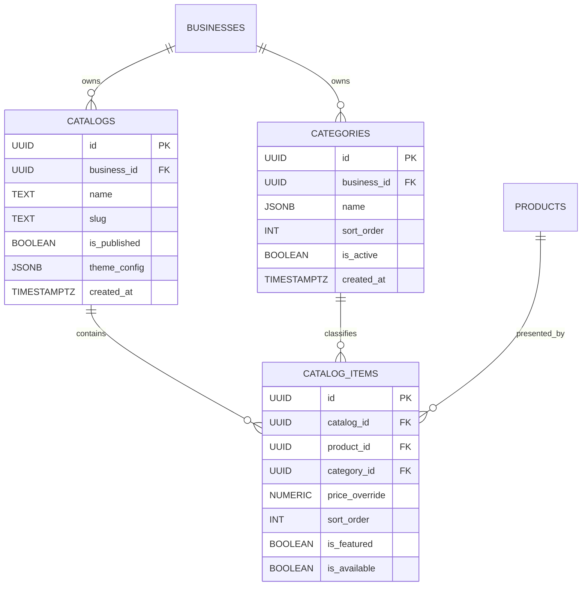

# Data Model: Catalog & Category Management (CAT-001)

**Feature**: `CAT-001: Catalog and Category Management`  
**Date**: 2026-11-06  
**Status**: Completed

---

## 1. Core Entities



---

### Entity: `Category` (`public.categories`)

| Field | Type | Constraints | Description |
|---|---|---|---|
| `id` | `UUID` | `PRIMARY KEY DEFAULT gen_random_uuid()` | Unique category identifier |
| `business_id` | `UUID` | `NOT NULL REFERENCES businesses(id) ON DELETE CASCADE` | Scoped tenant ID |
| `name` | `JSONB` | `NOT NULL` | Localized name `{ "ar": "...", "en": "..." }` |
| `sort_order` | `INT` | `NOT NULL DEFAULT 0` | Visual display ordering index |
| `is_active` | `BOOLEAN` | `NOT NULL DEFAULT true` | Storefront visibility toggle |
| `created_at` | `TIMESTAMPTZ` | `NOT NULL DEFAULT NOW()` | Creation timestamp |

---

### Entity: `Catalog` (`public.catalogs`)

| Field | Type | Constraints | Description |
|---|---|---|---|
| `id` | `UUID` | `PRIMARY KEY DEFAULT gen_random_uuid()` | Unique catalog presentation identifier |
| `business_id` | `UUID` | `NOT NULL REFERENCES businesses(id) ON DELETE CASCADE` | Scoped tenant ID |
| `name` | `TEXT` | `NOT NULL` | Display name (e.g. "قائمة المتجر الرئيسية") |
| `slug` | `TEXT` | `NOT NULL` | URL presentation slug |
| `is_published` | `BOOLEAN` | `NOT NULL DEFAULT true` | Public accessibility toggle |
| `theme_config` | `JSONB` | `NOT NULL DEFAULT '{}'` | Industry theme presets and styling |
| `created_at` | `TIMESTAMPTZ` | `NOT NULL DEFAULT NOW()` | Creation timestamp |

---

### Entity: `CatalogItem` (`public.catalog_items`)

| Field | Type | Constraints | Description |
|---|---|---|---|
| `id` | `UUID` | `PRIMARY KEY DEFAULT gen_random_uuid()` | Unique catalog item placement identifier |
| `catalog_id` | `UUID` | `NOT NULL REFERENCES catalogs(id) ON DELETE CASCADE` | Scoped catalog presentation |
| `product_id` | `UUID` | `NOT NULL REFERENCES products(id) ON DELETE CASCADE` | Reference to master inventory product |
| `category_id` | `UUID` | `NOT NULL REFERENCES categories(id) ON DELETE RESTRICT` | Associated category in this catalog |
| `price_override` | `NUMERIC(12, 2)` | `NULLABLE` | Optional presentation price override |
| `sort_order` | `INT` | `NOT NULL DEFAULT 0` | Item display ordering within category |
| `is_featured` | `BOOLEAN` | `NOT NULL DEFAULT false` | Promotional badge and highlight flag |
| `is_available` | `BOOLEAN` | `NOT NULL DEFAULT true` | In-catalog availability status |

---

## 2. Validation Schemas (Zod)

### Localized Category Name Schema
```typescript
import { z } from 'zod';

export const LocalizedStringSchema = z.object({
  ar: z.string('اسم التصنيف بالعربية مطلوب')
    .trim()
    .min(1, 'اسم التصنيف بالعربية مطلوب')
    .max(80, 'اسم التصنيف طويل جداً'),
  en: z.string().trim().max(80, 'الاسم بالإنجليزية طويل جداً').optional(),
});
```

### Category Input & Mutation Schemas
```typescript
export const CategoryInputSchema = z.object({
  name: LocalizedStringSchema,
  sort_order: z.number().int().default(0),
  is_active: z.boolean().default(true),
});
export type CategoryInput = z.infer<typeof CategoryInputSchema>;

export const UpdateCategoryInputSchema = CategoryInputSchema.partial();
export type UpdateCategoryInput = z.infer<typeof UpdateCategoryInputSchema>;

export const BatchReorderCategoriesSchema = z.array(
  z.object({
    id: z.string().uuid(),
    sort_order: z.number().int().nonnegative(),
  })
);
export type BatchReorderCategoriesInput = z.infer<typeof BatchReorderCategoriesSchema>;
```

### Catalog Item Curation Schema
```typescript
export const CatalogItemInputSchema = z.object({
  catalog_id: z.string().uuid('معرف القائمة غير صالح'),
  product_id: z.string().uuid('معرف المنتج غير صالح'),
  category_id: z.string().uuid('معرف التصنيف غير صالح'),
  price_override: z.number().positive('السعر المعدل يجب أن يكون أكبر من صفر').nullable().optional(),
  sort_order: z.number().int().default(0),
  is_featured: z.boolean().default(false),
  is_available: z.boolean().default(true),
});
export type CatalogItemInput = z.infer<typeof CatalogItemInputSchema>;

export const UpdateCatalogItemInputSchema = z.object({
  category_id: z.string().uuid().optional(),
  price_override: z.number().positive().nullable().optional(),
  sort_order: z.number().int().optional(),
  is_featured: z.boolean().optional(),
  is_available: z.boolean().optional(),
});
export type UpdateCatalogItemInput = z.infer<typeof UpdateCatalogItemInputSchema>;
```

