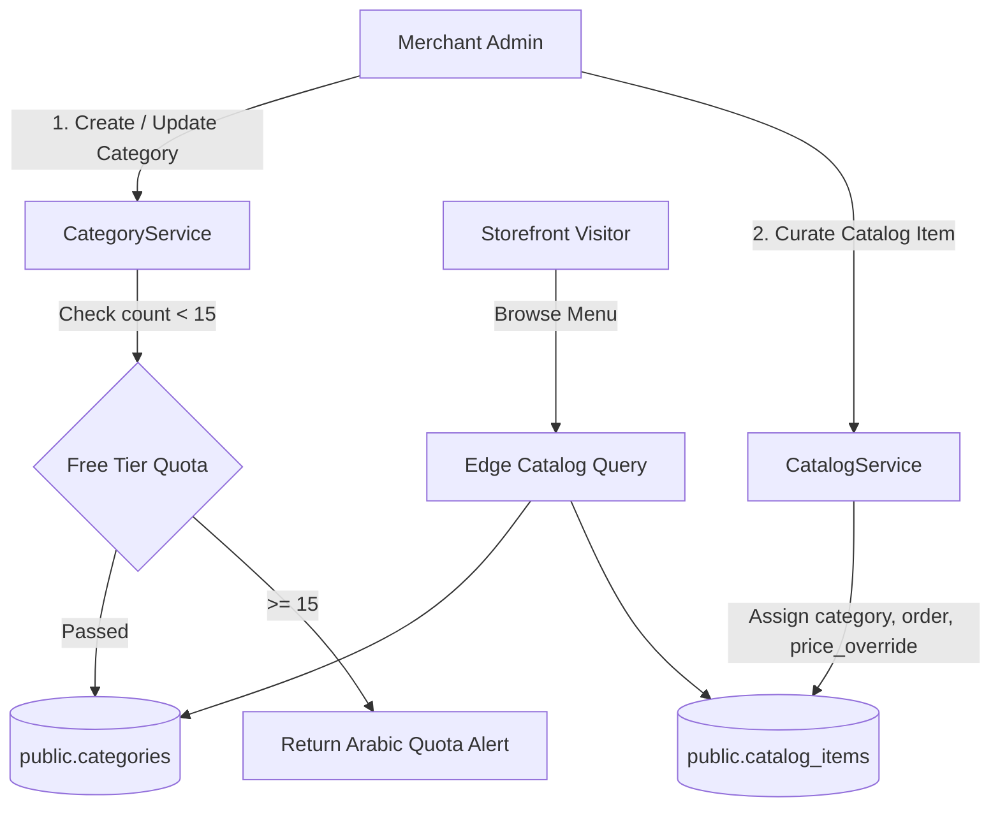

# Implementation Plan: Catalog and Category Management (CAT-001)

**Branch**: `004-catalog-management` | **Feature ID**: `CAT-001` | **Date**: 2026-11-06 | **Spec**: [spec.md](./spec.md)

**Input**: Feature specification from `/specs/004-catalog-management/spec.md`

---

## Summary

Enable merchants to structure and curate their commercial offerings into ordered categories (e.g. "مقبلات", "مشويات", "حلويات", "عصائر") and maintain the presentation catalogs that storefront visitors browse. Separates master inventory from presentation catalogs, allowing flexible product placement, category-based navigation, featured product badges, and catalog-specific price adjustments without corrupting core inventory records.

---

## Technical Context

**Language/Version**: TypeScript 5.7+ / PostgreSQL 15+ / React 19

**Primary Dependencies**:
- Full-stack Framework: `@tanstack/react-start` (Vite-powered edge SSR)
- Routing & Data: `@tanstack/react-router`, `@tanstack/react-query`
- Database Client: `@supabase/supabase-js` (PostgREST over HTTPS)
- Validation: `zod`
- Icons & UI: `lucide-react`, `tailwindcss`

**Storage**:
- PostgreSQL Tables: `public.categories`, `public.catalogs`, `public.catalog_items`
- Indexes: `idx_categories_business (business_id, sort_order)`, `idx_catalog_items_catalog (catalog_id, sort_order)`

**Testing**:
- Unit Tests: Node native test runner (`node:test`, `node:assert/strict`)
- Type Checking: `npx tsc --noEmit`

**Target Platform**: Cloudflare Workers (SSR pass-through) + Modern Web Browsers

**Project Type**: Full-Stack SaaS Tenant Catalog & Category Management

**Performance Goals**:
- Category creation / update: < 200ms
- Category batch reordering: < 300ms
- Public catalog category fetch: < 150ms

**Constraints**:
- Strict $0 monthly infrastructure cost (Single shared PostgreSQL instance)
- Hard limit of 15 categories for Free plan accounts
- Foreign key RESTRICT prevents orphan products upon category deletion

---

## Constitution Check

*GATE: Must pass before Phase 0 research. Re-check after Phase 1 design.*

| Principle | Compliance Assessment | Status |
|---|---|---|
| **I. Spec-Driven & Plan-First** | Work strictly bounded to `specs/004-catalog-management/spec.md` with verified acceptance criteria and quality checklist. | **PASS** |
| **II. Free-First & Zero-Cost Guardrails** | Category limit (15 max) strictly enforced on server before database mutation. | **PASS** |
| **III. Single Source of Truth for Security** | Categories and catalogs scoped to `business_id` and protected by RLS via `is_business_member()`. | **PASS** |
| **IV. Mobile-First & Edge Public Experience** | Category names, active flags, and item ordering optimized for edge caching and mobile storefronts. | **PASS** |
| **V. Decoupled Catalog Domain** | Strictly separates master inventory (`products`) from presentation catalog views (`catalog_items`). | **PASS** |
| **VI. Non-Blocking Dynamics & Privacy** | Category queries return purely structural catalog data without tracking visitor IDs. | **PASS** |
| **VII. Impeccable Design & Arabic-First** | Mandatory Arabic names (`ar`) with clean RTL typography and optional English (`en`). | **PASS** |
| **VIII. Database Architecture & Governance** | Operates on existing schema tables in `public` without unapproved DDL modifications. | **PASS** |
| **IX. Agent Governance & Scoping** | Execution strictly within scoped files; changes audited and verified. | **PASS** |
| **X. Modular Feature Decomposition** | Feature strictly bounded to `CAT-001`, cleanly decoupled from `PRD-001` (Products) and `PUB-001` (Storefront). | **PASS** |

*Post-Design Gate Result*: **ALL 10 CONSTITUTIONAL GATES PASSED (10/10)**.

---

## Project Structure

### Documentation (`specs/004-catalog-management/`)

```text
specs/004-catalog-management/
├── spec.md              # Feature specification (Approved)
├── plan.md              # Implementation plan (This file)
├── research.md          # Technical research (bilingual storage, decoupled curation, quota)
├── data-model.md        # Entities, Zod schemas, and validation rules
├── quickstart.md        # Runnable verification scenarios
├── contracts/
│   └── catalog-contracts.ts # TypeScript interfaces and contracts
└── checklists/
    └── requirements.md  # Quality checklist
```

### Source Code Mapping (`src/`)

```text
src/
├── server/
│   └── services/
│       ├── category.ts       # CategoryService (getCategories, createCategory, updateCategory, deleteCategory, reorder)
│       └── catalog.ts        # CatalogService (getCatalogItems, addCatalogItem, updateCatalogItem, removeCatalogItem)
├── shared/
│   ├── types.ts              # Domain entities (Category, Catalog, CatalogItem)
│   └── schemas.ts            # Shared Zod validation schemas
```

---

## Architecture Flow


