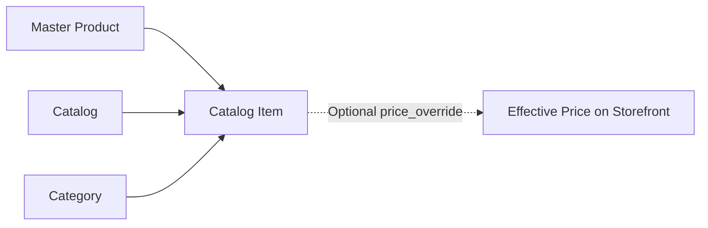

# Technical Research: Catalog & Category Management (CAT-001)

**Feature**: `CAT-001: Catalog and Category Management`  
**Date**: 2026-11-06  
**Status**: Completed

---

## 1. Bilingual Category Structure & Serialization

### Context
Every store category in the Egyptian and regional market requires an authentic Arabic name (e.g. "مشويات", "وجبات سريعة", "مشروبات ساخنة"). Merchants catering to mixed clientele or tourists frequently request optional English translations (e.g. "Grills", "Fast Food", "Hot Drinks").

### Database Storage Strategy
In PostgreSQL 15+, categories store names in a `JSONB` column:
```sql
name JSONB NOT NULL -- { "ar": "مشويات", "en": "Grills" }
```
- **Advantages**:
  - No database migration needed when adding additional language fields in the future.
  - Efficient indexing and extraction via PostgreSQL JSON operators (`name->>'ar'`).
  - Seamless integration with TanStack Form and Zod client validation.

### Validation Pattern (Zod)
```typescript
export const LocalizedStringSchema = z.object({
  ar: z.string('اسم التصنيف بالعربية مطلوب')
    .trim()
    .min(1, 'اسم التصنيف بالعربية مطلوب')
    .max(80, 'اسم التصنيف طويل جداً'),
  en: z.string().trim().max(80, 'الاسم بالإنجليزية طويل جداً').optional(),
});
```

---

## 2. Decoupled Catalog Architecture (Master Product vs. Catalog Item)

### Architectural Principle (Constitution Principle V)
The core architecture strictly separates **master inventory** from **presentation catalogs**:
1. **Master Product (`products`)**: Holds canonical SKU, base price, inventory status, and global attributes.
2. **Presentation Catalog (`catalogs`)**: Represents a curated storefront view (e.g. "قائمة الصيف", "منيو الفرع الرئيسي").
3. **Catalog Item (`catalog_items`)**: The join table curating the presentation:
   - Specific display category (`category_id`)
   - Presentation sort order (`sort_order`)
   - Optional price override (`price_override NUMERIC(12, 2)`)
   - Promotional highlight flag (`is_featured BOOLEAN`)
   - Presentation availability (`is_available BOOLEAN`)



### Effective Price Evaluation Algorithm
When public catalogs render a product, the effective price is calculated deterministically:
$$\text{effective\_price} = \begin{cases} \text{catalog\_item.price\_override} & \text{if } \text{catalog\_item.price\_override} \text{ is not null} \\ \text{product.base\_price} & \text{otherwise} \end{cases}$$

---

## 3. Free Plan Quota Enforcement (Max 15 Categories)

### Principle & Strategy
Constitution Principle II dictates that limits must be enforced on the server before database mutation. On the Free tier, each business is allotted up to 15 categories.

### Implementation Pattern in `CategoryService.createCategory`
```typescript
const { count, error: countError } = await supabase
  .from('categories')
  .select('*', { count: 'exact', head: true })
  .eq('business_id', businessId);

if (countError) throw new Error(`Failed to check category count: ${countError.message}`);

if ((count ?? 0) >= 15) {
  throw new Error('تم الوصول للحد الأقصى للتصنيفات في الخطة المجانية (15 تصنيفاً). يرجى ترقية باقتك لإضافة المزيد.');
}
```

---

## 4. Multi-Tenant Row Level Security (RLS) Boundaries

All three tables are secured in `public` schema:
- `categories`: Scoped by `business_id`
- `catalogs`: Scoped by `business_id`
- `catalog_items`: Scoped through `catalog_id` joining `catalogs.business_id`

### Read Policy (Public & Merchant)
- Public visitors can select active categories (`is_active = true`) and published catalogs (`is_published = true`).
- Authenticated store members (`owner`, `admin`, `editor`, `viewer`) can select all rows matching `is_business_member(business_id)`.

### Mutation Policy (Merchant Owners & Admins)
- Category and Catalog insertion, update, and deletion require `has_minimum_role('admin')` or `is_business_owner()`.

