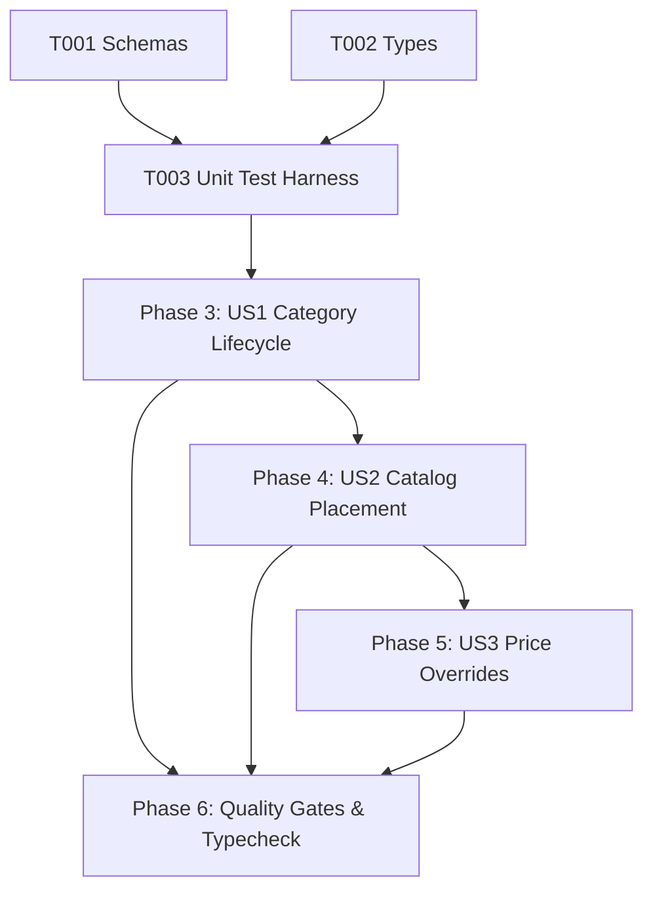

# Tasks: Catalog and Category Management (CAT-001)

**Input**: Design documents from `/specs/004-catalog-management/` (`spec.md`, `plan.md`, `research.md`, `data-model.md`, `contracts/catalog-contracts.ts`, `quickstart.md`)

**Prerequisites**: Approved `spec.md` and `plan.md` (Constitutional Gates: 10/10 Passed)

**Organization**: Grouped by prioritized user stories to enable independent implementation and testable increments.

---

## Phase 1: Setup & Shared Utilities

**Purpose**: Shared validation logic and interface contracts

- [x] T001 [P] Verify `CategoryInputSchema`, `UpdateCategoryInputSchema`, and `CatalogItemInputSchema` in `src/shared/schemas.ts`.
- [x] T002 [P] Align `Category`, `Catalog`, and `CatalogItem` interfaces in `src/shared/types.ts`.

---

## Phase 2: Foundational Test Harness

**Purpose**: Automated test suite for bilingual categories, quota enforcement, catalog items, and effective price calculation

- [x] T003 [P] Create unit test suite in `tests/unit/catalog-management.test.ts` (testing bilingual Arabic/English names, 15-category quota rejection, catalog item placement, and price overrides).

**Checkpoint**: Validation schemas and unit test harness ready.

---

## Phase 3: User Story 1 - Category Lifecycle & Hierarchy (Priority: P1) 🎯 MVP

**Goal**: Enable merchants to create, reorder, edit, and toggle active state of categories up to the 15-category Free limit.

**Independent Test**: Create categories with sort order, update names, verify ascending retrieval order, and attempt a 16th category to verify quota rejection.

- [x] T004 [US1] Implement and verify `createCategory` with 15-category Free tier quota check in `src/server/services/category.ts`.
- [x] T005 [US1] Implement and verify `getCategories` with ascending sort order ordering in `src/server/services/category.ts`.
- [x] T006 [US1] Implement and verify `updateCategory` and `deleteCategory` in `src/server/services/category.ts`.
- [x] T007 [US1] Implement `reorderCategories` batch update method in `src/server/services/category.ts`.

**Checkpoint**: Category lifecycle and 15-category quota engine operational.

---

## Phase 4: User Story 2 - Curated Catalog Placement & Item Presentation (Priority: P1) 🎯 MVP

**Goal**: Place master products into catalog categories with presentation order, availability toggles, and featured product highlights.

**Independent Test**: Add a product to a catalog item row, toggle `is_featured`, and query catalog items to verify correct category mapping.

- [x] T008 [US2] Implement `CatalogService` in `src/server/services/catalog.ts` (`getCatalogItems`, `addCatalogItem`, `removeCatalogItem`).
- [x] T009 [US2] Support `is_featured` and `is_available` presentation toggles in `src/server/services/catalog.ts`.

**Checkpoint**: Catalog curation and product presentation mapping operational.

---

## Phase 5: User Story 3 - Presentation Price Overrides & Independent Availability (Priority: P2)

**Goal**: Allow merchants to set promotional presentation price overrides on catalog items without altering master inventory prices.

**Independent Test**: Set `price_override = 85.00` on a catalog item with master product price 100.00, verifying that public catalog queries return 85.00 while the master product remains 100.00.

- [x] T010 [US3] Implement `updateCatalogItem` with `price_override` handling and null clearing in `src/server/services/catalog.ts`.
- [x] T011 [US3] Implement effective price calculation utility (`calculateEffectivePrice`) in `src/server/services/catalog.ts`.

**Checkpoint**: Presentation price overrides and effective price calculation operational.

---

## Phase 6: Polish, Automated Verification & Quality Gates

**Purpose**: Cross-cutting verification, type safety, and end-to-end testing

- [x] T012 Run automated unit test suite (`node --test tests/unit/*.test.ts`) covering all 5 test suites (redirect, auth error mapper, tenant auth, business management, catalog management).
- [x] T013 Execute strict TypeScript typecheck (`npx tsc --noEmit`) and resolve any warnings.
- [x] T014 Verify compliance with all acceptance scenarios in `specs/004-catalog-management/quickstart.md`.

---

## Dependencies & Execution Order

