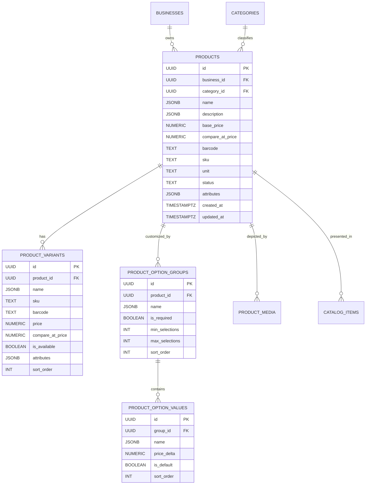

# Data Model: Product, Variant, and Modifier Management (PRD-001)

**Feature**: `PRD-001: Product, Variant, and Modifier Management`  
**Date**: 2026-11-06  
**Status**: Completed

---

## 1. Core Entities & Relationships



---

### Entity: `Product` (`public.products`)

| Field | Type | Constraints | Description |
|---|---|---|---|
| `id` | `UUID` | `PRIMARY KEY DEFAULT gen_random_uuid()` | Unique product identifier |
| `business_id` | `UUID` | `NOT NULL REFERENCES businesses(id) ON DELETE CASCADE` | Scoped tenant ID |
| `category_id` | `UUID` | `NOT NULL REFERENCES categories(id) ON DELETE RESTRICT` | Primary category ID |
| `name` | `JSONB` | `NOT NULL` | Localized name `{ "ar": "...", "en": "..." }` |
| `description` | `JSONB` | `NULLABLE` | Localized description `{ "ar": "...", "en": "..." }` |
| `base_price` | `NUMERIC(12, 2)`| `NULLABLE` | Standard base selling price (EGP) |
| `compare_at_price` | `NUMERIC(12, 2)`| `NULLABLE` | Strikethrough/original price for discount display |
| `barcode` | `TEXT` | `NULLABLE` | EAN-13, UPC, or custom barcode string |
| `sku` | `TEXT` | `NULLABLE` | Stock Keeping Unit code |
| `unit` | `TEXT` | `NOT NULL DEFAULT 'piece'` | Commercial unit (`piece`, `kg`, `g`, `pack`) |
| `status` | `TEXT` | `NOT NULL DEFAULT 'active'` | `'active'`, `'out_of_stock'`, `'archived'` |
| `attributes` | `JSONB` | `NOT NULL DEFAULT '{}'` | Industry presets (calories, allergens, sizes) |
| `created_at` | `TIMESTAMPTZ` | `NOT NULL DEFAULT NOW()` | Creation timestamp |
| `updated_at` | `TIMESTAMPTZ` | `NOT NULL DEFAULT NOW()` | Last update timestamp |

---

### Entity: `ProductVariant` (`public.product_variants`)

| Field | Type | Constraints | Description |
|---|---|---|---|
| `id` | `UUID` | `PRIMARY KEY DEFAULT gen_random_uuid()` | Unique variant identifier |
| `product_id` | `UUID` | `NOT NULL REFERENCES products(id) ON DELETE CASCADE` | Parent product reference |
| `name` | `JSONB` | `NOT NULL` | Localized variant name (e.g. "حجم كبير") |
| `sku` | `TEXT` | `NULLABLE` | Variant-specific SKU |
| `barcode` | `TEXT` | `NULLABLE` | Variant-specific barcode |
| `price` | `NUMERIC(12, 2)`| `NOT NULL CHECK (price > 0)` | Price for this specific variant |
| `compare_at_price` | `NUMERIC(12, 2)`| `NULLABLE` | Pre-discount price for this variant |
| `is_available` | `BOOLEAN` | `NOT NULL DEFAULT true` | In-stock availability toggle |
| `attributes` | `JSONB` | `NOT NULL DEFAULT '{}'` | Variant attributes (e.g. `{ "size": "XL" }`) |
| `sort_order` | `INT` | `NOT NULL DEFAULT 0` | Visual display ordering index |

---

### Entity: `ProductOptionGroup` (`public.product_option_groups`)

| Field | Type | Constraints | Description |
|---|---|---|---|
| `id` | `UUID` | `PRIMARY KEY DEFAULT gen_random_uuid()` | Unique option group identifier |
| `product_id` | `UUID` | `NOT NULL REFERENCES products(id) ON DELETE CASCADE` | Parent product reference |
| `name` | `JSONB` | `NOT NULL` | Localized group name (e.g. "إضافات مميزة") |
| `is_required` | `BOOLEAN` | `NOT NULL DEFAULT false` | Whether selection is mandatory |
| `min_selections` | `INT` | `NOT NULL DEFAULT 0` | Minimum allowed selections |
| `max_selections` | `INT` | `NOT NULL DEFAULT 1` | Maximum allowed selections |
| `sort_order` | `INT` | `NOT NULL DEFAULT 0` | Display sort order among modifier groups |

---

### Entity: `ProductOptionValue` (`public.product_option_values`)

| Field | Type | Constraints | Description |
|---|---|---|---|
| `id` | `UUID` | `PRIMARY KEY DEFAULT gen_random_uuid()` | Unique option value identifier |
| `group_id` | `UUID` | `NOT NULL REFERENCES product_option_groups(id) ON DELETE CASCADE` | Parent option group |
| `name` | `JSONB` | `NOT NULL` | Localized value name (e.g. "جبنة إضافية") |
| `price_delta` | `NUMERIC(12, 2)`| `NOT NULL DEFAULT 0.00` | Additional cost added to base price |
| `is_default` | `BOOLEAN` | `NOT NULL DEFAULT false` | Whether pre-selected by default |
| `sort_order` | `INT` | `NOT NULL DEFAULT 0` | Display sort order within option group |

---

## 2. Validation Schemas (Zod 4 Compliant)

```typescript
import { z } from 'zod';

export const LocalizedStringSchema = z.object({
  ar: z.string('النص العربي مطلوب').trim().min(1, 'النص العربي مطلوب'),
  en: z.string().trim().optional(),
});

export const ProductVariantSchema = z.object({
  id: z.string().uuid().optional(),
  name: LocalizedStringSchema,
  sku: z.string().optional(),
  barcode: z.string().optional(),
  price: z.number().positive('سعر المتغير يجب أن يكون أكبر من صفر'),
  compare_at_price: z.number().positive().optional(),
  is_available: z.boolean().default(true),
  attributes: z.record(z.string(), z.string()).default({}),
  sort_order: z.number().int().default(0),
});

export const ProductOptionValueSchema = z.object({
  id: z.string().uuid().optional(),
  name: LocalizedStringSchema,
  price_delta: z.number().nonnegative().default(0),
  is_default: z.boolean().default(false),
  sort_order: z.number().int().default(0),
});

export const ProductOptionGroupSchema = z.object({
  id: z.string().uuid().optional(),
  name: LocalizedStringSchema,
  is_required: z.boolean().default(false),
  min_selections: z.number().int().nonnegative().default(0),
  max_selections: z.number().int().positive().default(1),
  sort_order: z.number().int().default(0),
  values: z.array(ProductOptionValueSchema).min(1, 'مجموعة الخيارات يجب أن تحتوي على خيار واحد على الأقل'),
}).refine(
  (group) => group.min_selections <= group.max_selections,
  {
    message: 'الحد الأدنى للاختيارات لا يمكن أن يتجاوز الحد الأقصى',
    path: ['min_selections'],
  }
);

export const CreateProductInputSchema = z.object({
  category_id: z.string().uuid('معرف التصنيف غير صالح'),
  name: LocalizedStringSchema,
  description: LocalizedStringSchema.optional(),
  base_price: z.number().nonnegative('لا يمكن أن يكون السعر سالباً').optional(),
  compare_at_price: z.number().positive().optional(),
  barcode: z.string().optional(),
  sku: z.string().optional(),
  unit: z.string().default('piece'),
  status: z.enum(['active', 'out_of_stock', 'archived']).default('active'),
  attributes: z.record(z.string(), z.any()).default({}),
  variants: z.array(ProductVariantSchema).max(10, 'الحد الأقصى للمتغيرات هو 10 متغيرات').default([]),
  option_groups: z.array(ProductOptionGroupSchema).default([]),
  image_urls: z.array(z.string().url()).max(3, 'الحد الأقصى هو 3 صور لكل منتج').default([]),
});

export const UpdateProductInputSchema = CreateProductInputSchema.partial();
```

