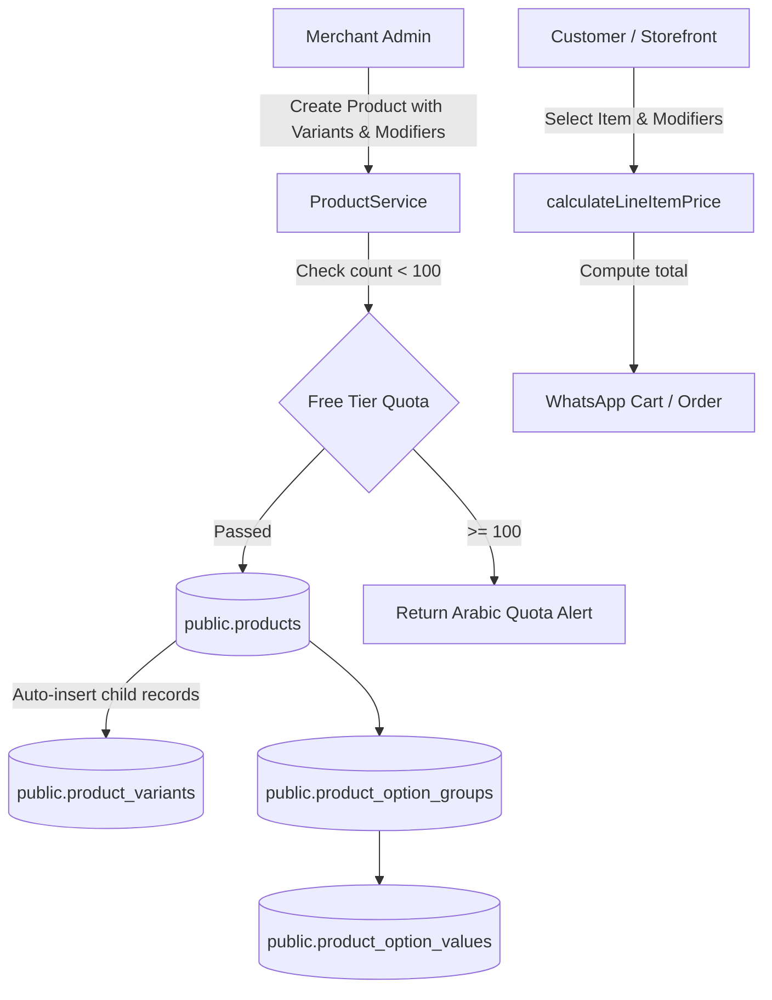

# Implementation Plan: Product, Variant, and Modifier Management (PRD-001)

**Branch**: `005-product-management` | **Feature ID**: `PRD-001` | **Date**: 2026-11-06 | **Spec**: [spec.md](./spec.md)

**Input**: Feature specification from `/specs/005-product-management/spec.md`

---

## Summary

Allow merchants to establish, price, and maintain their core product inventory—the items that populate their digital menus and online catalogs. Supports multi-size/multi-attribute variations (e.g., Small / Medium / Large, Colors, Flavors) and customizable customer modifier groups (e.g., Extra Cheese, Sugar Level, Cooking Preference) with deterministic price calculations. Strictly enforces the Free-First platform quota (maximum 100 active products per business) and maintains full Arabic-first typography.

---

## Technical Context

**Language/Version**: TypeScript 5.7+ / PostgreSQL 15+ / React 19

**Primary Dependencies**:
- Full-stack Framework: `@tanstack/react-start` (Vite-powered edge SSR)
- Routing & Data: `@tanstack/react-router`, `@tanstack/react-query`
- Database Client: `@supabase/supabase-js` (PostgREST over HTTPS)
- Validation: `zod`
- Icons & UI: `lucide-react`, `tailwindcss`

**Storage**:
- PostgreSQL Tables: `public.products`, `public.product_variants`, `public.product_option_groups`, `public.product_option_values`
- Indexes: `idx_products_business_status (business_id, status)`, `idx_variants_product (product_id, sort_order)`, `idx_option_groups_product (product_id, sort_order)`, `idx_option_values_group (group_id, sort_order)`

**Testing**:
- Unit Tests: Node native test runner (`node:test`, `node:assert/strict`)
- Type Checking: `npx tsc --noEmit`

**Target Platform**: Cloudflare Workers (SSR pass-through) + Modern Web Browsers

**Project Type**: Full-Stack SaaS Master Inventory, Variants, and Modifiers

**Performance Goals**:
- Product creation with variants & modifiers: < 500ms
- Product list fetch: < 250ms
- Effective line item price calculation: < 1ms (pure in-memory)

**Constraints**:
- Strict $0 monthly infrastructure cost (Single shared PostgreSQL instance)
- Hard limit of 100 products for Free plan accounts
- Foreign key CASCADE on child entities (variants, option groups, option values)

---

## Constitution Check

*GATE: Must pass before Phase 0 research. Re-check after Phase 1 design.*

| Principle | Compliance Assessment | Status |
|---|---|---|
| **I. Spec-Driven & Plan-First** | Work strictly bounded to `specs/005-product-management/spec.md` with verified acceptance criteria and quality checklist. | **PASS** |
| **II. Free-First & Zero-Cost Guardrails** | 100-product quota strictly enforced at application service level with DB trigger guard. | **PASS** |
| **III. Single Source of Truth for Security** | Products scoped to `business_id` and protected by RLS via `is_business_member()`. | **PASS** |
| **IV. Mobile-First & Edge Public Experience** | Product attributes and variant prices structured for lightweight JSON edge hydration. | **PASS** |
| **V. Decoupled Catalog Domain** | Master products remain strictly independent from presentation catalog items and price overrides. | **PASS** |
| **VI. Non-Blocking Dynamics & Privacy** | Product queries are strictly inventory data without embedding user tracking identifiers. | **PASS** |
| **VII. Impeccable Design & Arabic-First** | Mandatory Arabic names (`ar`) with clean RTL typography and optional English (`en`). | **PASS** |
| **VIII. Database Architecture & Governance** | Operates on existing schema tables in `public` without unapproved DDL modifications. | **PASS** |
| **IX. Agent Governance & Scoping** | Execution strictly within scoped files; changes audited and verified. | **PASS** |
| **X. Modular Feature Decomposition** | Feature strictly bounded to `PRD-001`, cleanly decoupled from `MED-001` (Media) and `CAT-001` (Catalog). | **PASS** |

*Post-Design Gate Result*: **ALL 10 CONSTITUTIONAL GATES PASSED (10/10)**.

---

## Project Structure

### Documentation (`specs/005-product-management/`)

```text
specs/005-product-management/
├── spec.md              # Feature specification (Approved)
├── plan.md              # Implementation plan (This file)
├── research.md          # Technical research (pricing hierarchy, quota, modifiers)
├── data-model.md        # Entities, Zod schemas, and validation rules
├── quickstart.md        # Runnable verification scenarios
├── contracts/
│   └── product-contracts.ts # TypeScript interfaces and contracts
└── checklists/
    └── requirements.md  # Quality checklist
```

### Source Code Mapping (`src/`)

```text
src/
├── server/
│   └── services/
│       └── product.ts        # ProductService (getProducts, createProduct, updateProduct, calculateLineItemPrice)
├── shared/
│   ├── types.ts              # Domain entities (Product, ProductVariant, ProductOptionGroup, ProductOptionValue)
│   └── schemas.ts            # Shared Zod validation schemas
```

---

## Architecture Flow


