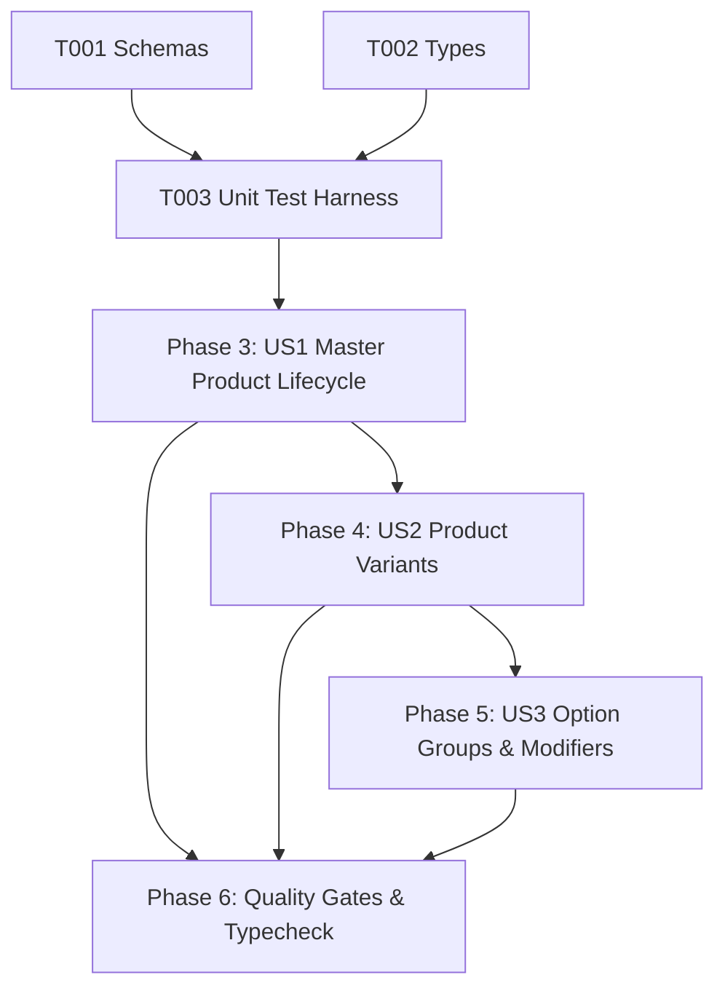

# Tasks: Product, Variant, and Modifier Management (PRD-001)

**Input**: Design documents from `/specs/005-product-management/` (`spec.md`, `plan.md`, `research.md`, `data-model.md`, `contracts/product-contracts.ts`, `quickstart.md`)

**Prerequisites**: Approved `spec.md` and `plan.md` (Constitutional Gates: 10/10 Passed)

**Organization**: Grouped by prioritized user stories to enable independent implementation and testable increments.

---

## Phase 1: Setup & Shared Utilities

**Purpose**: Shared validation logic and interface contracts

- [x] T001 [P] Verify and align Zod 4 validation schemas in `src/shared/schemas.ts` (`CreateProductInputSchema`, `ProductVariantSchema`, `ProductOptionGroupSchema`, `ProductOptionValueSchema`).
- [x] T002 [P] Align `Product`, `ProductVariant`, `ProductOptionGroup`, `ProductOptionValue` in `src/shared/types.ts`.

---

## Phase 2: Foundational Test Harness

**Purpose**: Automated test suite for product validation, variants, modifier bounds, deterministic price calculation, and quota enforcement

- [x] T003 [P] Create unit test suite in `tests/unit/product-management.test.ts` (testing product schema validation, variant constraints, option group min/max selection bounds, deterministic price resolution, and 100-product quota rejection).

**Checkpoint**: Validation schemas and unit test harness ready.

---

## Phase 3: User Story 1 - Master Product Definition & Availability (Priority: P1) 🎯 MVP

**Goal**: Enable merchants to create, update, toggle availability, and delete master products within the 100-product Free tier quota.

**Independent Test**: Create a product with name, category, and base price, verify presence in product list, toggle availability, and attempt a 101st product to verify quota rejection.

- [x] T004 [US1] Implement and verify `createProduct` with 100-product Free tier quota check in `src/server/services/product.ts`.
- [x] T005 [US1] Implement and verify `getProducts` and `getProductById` in `src/server/services/product.ts`.
- [x] T006 [US1] Implement `updateProduct` and `setAvailability` status toggles in `src/server/services/product.ts`.
- [x] T007 [US1] Implement `deleteProduct` in `src/server/services/product.ts`.

**Checkpoint**: Master product lifecycle and 100-product quota engine operational.

---

## Phase 4: User Story 2 - Product Variants (Sizes & Flavors) (Priority: P1) 🎯 MVP

**Goal**: Support multiple variations per product (e.g. Small / Medium / Large), each with its own price and availability status.

**Independent Test**: Create a product with 2 variants, verify variant rows in database, and confirm variant price overrides base price.

- [x] T008 [US2] Verify atomic insertion of `product_variants` in `createProduct` within `src/server/services/product.ts`.
- [x] T009 [US2] Implement variant price resolution in price calculation utility.

**Checkpoint**: Product variants and variant pricing operational.

---

## Phase 5: User Story 3 - Option Groups & Modifiers with Selection Bounds (Priority: P2)

**Goal**: Allow merchants to configure modifier groups with selection constraints (min/max/required) and price adjustments.

**Independent Test**: Attach option group with min 1, max 2 selections and verify that selecting valid options calculates the correct line item price.

- [x] T010 [US3] Verify atomic insertion of `product_option_groups` and `product_option_values` in `createProduct` within `src/server/services/product.ts`.
- [x] T011 [US3] Implement `validateOptionGroupSelections` and `calculateLineItemPrice` in `src/server/services/product.ts`.

**Checkpoint**: Option groups, modifiers, and deterministic price calculation operational.

---

## Phase 6: Polish, Automated Verification & Quality Gates

**Purpose**: Cross-cutting verification, type safety, and end-to-end testing

- [x] T012 Run automated unit test suite (`node --test tests/unit/*.test.ts`) covering all 6 test suites (redirect, auth error mapper, tenant auth, business management, catalog management, product management).
- [x] T013 Execute strict TypeScript typecheck (`npx tsc --noEmit`) and resolve any warnings.
- [x] T014 Verify compliance with all acceptance scenarios in `specs/005-product-management/quickstart.md`.

---

## Dependencies & Execution Order

