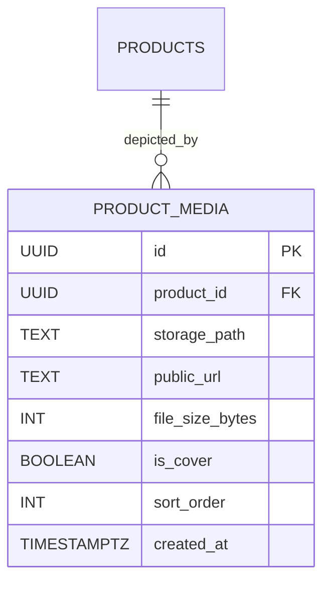

# Data Model: Product Media Management (MED-001)

**Feature**: `MED-001: Product Media Management`  
**Date**: 2026-11-06  
**Status**: Completed

---

## 1. Core Entities



### Entity: `ProductMedia` (`public.product_media`)

| Field | Type | Constraints | Description |
|---|---|---|---|
| `id` | `UUID` | `PRIMARY KEY DEFAULT gen_random_uuid()` | Unique media record identifier |
| `product_id` | `UUID` | `NOT NULL REFERENCES products(id) ON DELETE CASCADE` | Parent product reference |
| `storage_path` | `TEXT` | `NOT NULL` | Bucket object key (`{bizId}/{prodId}/{file}.webp`) |
| `public_url` | `TEXT` | `NOT NULL` | Public URL accessible by CDN and browsers |
| `file_size_bytes` | `INT` | `NOT NULL` | Post-compression size in bytes |
| `is_cover` | `BOOLEAN` | `NOT NULL DEFAULT false` | Primary preview flag for storefront cards |
| `sort_order` | `INT` | `NOT NULL DEFAULT 0` | Sequential gallery position (0, 1, 2) |
| `created_at` | `TIMESTAMPTZ` | `NOT NULL DEFAULT NOW()` | Creation timestamp |

---

## 2. Validation Schemas (Zod 4 Compliant)

```typescript
import { z } from 'zod';

export const ProductMediaInputSchema = z.object({
  product_id: z.string().uuid('معرف المنتج غير صالح'),
  storage_path: z.string().min(3, 'مسار الملف غير صالح'),
  public_url: z.string().url('رابط الصورة غير صالح'),
  file_size_bytes: z.number().int().positive('حجم الملف غير صالح').max(204800, 'حجم الملف يتجاوز الحد المسموح (200KB)'),
  is_cover: z.boolean().default(false),
  sort_order: z.number().int().nonnegative().default(0),
});
export type ProductMediaInput = z.infer<typeof ProductMediaInputSchema>;

export const UpdateMediaSortSchema = z.array(
  z.object({
    id: z.string().uuid('معرف الصورة غير صالح'),
    sort_order: z.number().int().nonnegative(),
  })
);
export type UpdateMediaSortInput = z.infer<typeof UpdateMediaSortSchema>;

export const SetCoverImageSchema = z.object({
  product_id: z.string().uuid('معرف المنتج غير صالح'),
  media_id: z.string().uuid('معرف الصورة غير صالح'),
});
export type SetCoverImageInput = z.infer<typeof SetCoverImageSchema>;
```

