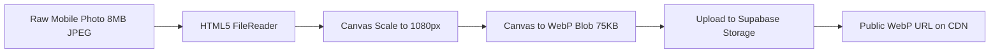

# Technical Research: Product Media Management (MED-001)

**Feature**: `MED-001: Product Media Management`  
**Date**: 2026-11-06  
**Status**: Completed

---

## 1. Client-Side WebP Compression Architecture

### Context & Challenge
Merchants upload product photos directly from modern smartphones (iOS / Android) where raw photos are often 4MB–12MB HEIC or JPEG files with 4000x3000px resolutions.
If uploaded directly:
1. They exhaust Supabase free storage (1 GB limit) in fewer than 100 products.
2. They overload mobile data plans for customers viewing the digital menu.
3. Network uploads fail frequently on unstable 3G/4G connections.

### Solution: Zero-Server-Cost Client-Side Transformation
Using HTML5 Canvas / Web API before network transmission:
1. **Dimensions**: Aspect-ratio preserving downscaling to a maximum of 1080px (width or height).
2. **Format**: Re-encoding to `image/webp` with 0.8 quality.
3. **Payload Reduction**: Achieves an average 85%–95% file size reduction (yielding typical files of 40KB–85KB).



---

## 2. Storage Path Hierarchy & Bucket Security

### Bucket Name: `product-images`
All assets are structured hierarchically:
`{business_id}/{product_id}/{timestamp}-{filename}.webp`

### Advantages:
- Prevents file name collisions across tenants and products.
- Enables single-query bulk deletion of all product images when a product is deleted (`supabase.storage.from('product-images').remove([paths])`).
- Bucket is public read-only, allowing Cloudflare CDN edge caching with zero compute cost.

---

## 3. Quota Governance (3 Images per Product)

### Policy (Constitution Principle II)
- Every product on the Free plan can hold a maximum of 3 images in `public.product_media`.
- Verified at service level before calling storage upload:
```typescript
const { count } = await supabase
  .from('product_media')
  .select('*', { count: 'exact', head: true })
  .eq('product_id', productId);

if ((count ?? 0) >= 3) {
  throw new Error('الحد الأقصى هو 3 صور لكل منتج في الباقة المجانية.');
}
```

---

## 4. Cover Image Integrity & Deletion Promotion

### Rules:
1. First uploaded image for any product is automatically `is_cover = true`.
2. Designating an image as cover updates that row to `is_cover = true` and all sibling rows for that product to `is_cover = false`.
3. When the current cover is deleted:
   - If other images exist, the image with the lowest `sort_order` is promoted to `is_cover = true`.
   - Ensures storefront cards always have an active cover preview.

