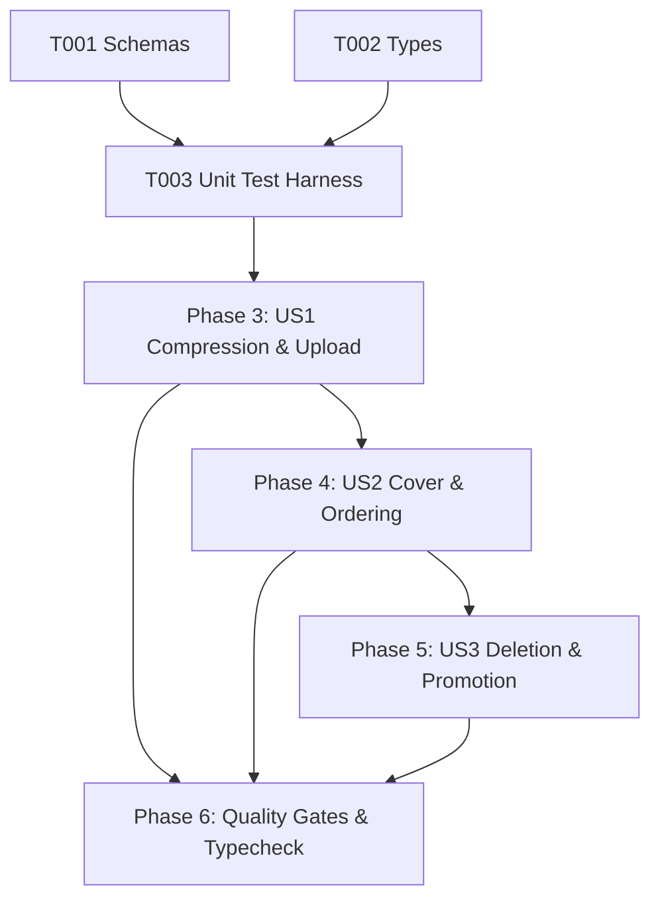

# Tasks: Product Media Management (MED-001)

**Input**: Design documents from `/specs/006-media-management/` (`spec.md`, `plan.md`, `research.md`, `data-model.md`, `contracts/media-contracts.ts`, `quickstart.md`)

**Prerequisites**: Approved `spec.md` and `plan.md` (Constitutional Gates: 10/10 Passed)

**Organization**: Grouped by prioritized user stories to enable independent implementation and testable increments.

---

## Phase 1: Setup & Shared Utilities

**Purpose**: Shared validation logic and interface contracts

- [x] T001 [P] Verify and add `ProductMediaInputSchema`, `UpdateMediaSortSchema`, and `SetCoverImageSchema` in `src/shared/schemas.ts`.
- [x] T002 [P] Verify `ProductMedia` interface in `src/shared/types.ts`.

---

## Phase 2: Foundational Test Harness

**Purpose**: Automated test suite for media schemas, WebP format validation, 200KB limits, cover reassignment, and quota enforcement

- [x] T003 [P] Create unit test suite in `tests/unit/media-management.test.ts` (testing media schemas, storage path generation, 200KB boundary, cover selection logic, and 3-image quota rejection).

**Checkpoint**: Validation schemas and unit test harness ready.

---

## Phase 3: User Story 1 - Client-Side WebP Compression & Upload (Priority: P1) 🎯 MVP

**Goal**: Transform images to WebP format, cap dimensions to 1080px, and upload to `product-images` bucket within 3-image quota.

**Independent Test**: Compress an image, verify MIME type `image/webp` and dimensions $\le$ 1080px, and upload via `storageService.upload` to verify public URL generation.

- [x] T004 [US1] Verify dimension scaling ($\le$ 1080px) and WebP compression logic in `src/client/utils/image-compressor.ts`.
- [x] T005 [US1] Verify storage provider uploads, custom domain URL formatting, and 200KB boundary in `src/server/services/storage.ts`.
- [x] T006 [US1] Implement `uploadProductImage` in `src/server/services/media.ts` enforcing the 3-image Free quota limit.

**Checkpoint**: WebP compression and storage upload operational.

---

## Phase 4: User Story 2 - Cover Image Selection & Gallery Reordering (Priority: P1) 🎯 MVP

**Goal**: Automatically set first image as cover, allow manual cover designation, and support gallery reordering.

**Independent Test**: Upload multiple images, verify first is cover, designate second as cover, and verify previous cover is demoted to `false`.

- [x] T007 [US2] Implement automatic cover assignment for first uploaded image (`is_cover = true`) in `src/server/services/media.ts`.
- [x] T008 [US2] Implement `setCoverImage` method in `src/server/services/media.ts` to switch active cover cleanly.
- [x] T009 [US2] Implement `reorderMedia` batch update in `src/server/services/media.ts`.

**Checkpoint**: Cover image management and gallery ordering operational.

---

## Phase 5: User Story 3 - Media Deletion & Automatic Cover Promotion (Priority: P2)

**Goal**: Atomically delete database record and storage asset, and promote remaining image to cover if active cover is deleted.

**Independent Test**: Delete active cover image and verify that remaining image is automatically promoted to `is_cover = true` and storage asset is removed.

- [x] T010 [US3] Implement `deleteProductImage` in `src/server/services/media.ts` with atomic storage bucket removal.
- [x] T011 [US3] Implement automatic cover promotion when active cover image is deleted.

**Checkpoint**: Media deletion and cover promotion operational.

---

## Phase 6: Polish, Automated Verification & Quality Gates

**Purpose**: Cross-cutting verification, type safety, and end-to-end testing

- [x] T012 Run automated unit test suite (`node --test tests/unit/*.test.ts`) covering all 7 test suites (redirect, auth error mapper, tenant auth, business management, catalog management, product management, media management).
- [x] T013 Execute strict TypeScript typecheck (`npx tsc --noEmit`) and resolve any warnings.
- [x] T014 Verify compliance with all acceptance scenarios in `specs/006-media-management/quickstart.md`.

---

## Dependencies & Execution Order

