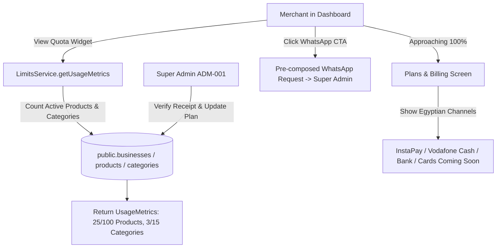

# Implementation Plan: Entitlements and Usage Limits (LMT-001)

**Branch**: `007-usage-limits` | **Feature ID**: `LMT-001` | **Date**: 2026-11-06 | **Spec**: [spec.md](./spec.md)

**Input**: Feature specification from `/specs/007-usage-limits/spec.md`

---

## Summary

Keep the free-tier offer predictable for merchants and sustainable for the platform. Provides real-time capacity gauges (`0/100 products`, `0/15 categories`) on the merchant dashboard, displays the Plans & Billing interface with local Egyptian payment channels (InstaPay, Vodafone Cash, Bank Transfer, and Visa/Mastercard marked "Coming Soon"), and establishes a direct WhatsApp manual upgrade flow verified by Platform Super Admin (`ADM-001`).

---

## Technical Context

**Language/Version**: TypeScript 5.7+ / PostgreSQL 15+ / React 19

**Primary Dependencies**:
- Full-stack Framework: `@tanstack/react-start` (Vite-powered edge SSR)
- Routing & Data: `@tanstack/react-router`, `@tanstack/react-query`
- Database Client: `@supabase/supabase-js` (PostgREST over HTTPS)
- Validation: `zod`
- Icons & UI: `lucide-react`, `tailwindcss`

**Storage**:
- PostgreSQL Tables: `public.businesses` (`plan_code`, `max_products`, `max_categories`), `public.products`, `public.categories`

**Testing**:
- Unit Tests: Node native test runner (`node:test`, `node:assert/strict`)
- Type Checking: `npx tsc --noEmit`

**Target Platform**: Cloudflare Workers (SSR pass-through) + Modern Web Browsers

**Project Type**: Tenant Usage Gauges & Egyptian Subscription Billing Flow

**Performance Goals**:
- Live usage gauge calculation: < 1ms (pure in-memory)
- Database quota pre-check: < 50ms (count head query)
- WhatsApp URL generator: < 1ms

**Constraints**:
- Strict $0 monthly infrastructure cost (No paid recurring billing SaaS dependencies like Stripe/Paddle)
- Merchants CANNOT modify their own plan tier or limits directly in DB (protected by RLS)
- Free tier defaults: 100 products, 15 categories, 3 images/product

---

## Constitution Check

*GATE: Must pass before Phase 0 research. Re-check after Phase 1 design.*

| Principle | Compliance Assessment | Status |
|---|---|---|
| **I. Spec-Driven & Plan-First** | Work strictly bounded to `specs/007-usage-limits/spec.md` with verified acceptance criteria and quality checklist. | **PASS** |
| **II. Free-First & Zero-Cost Guardrails** | Core free tier limits (100 products, 15 categories) permanently guaranteed with zero forced billing. | **PASS** |
| **III. Single Source of Truth for Security** | Entitlement fields (`plan_code`, `max_products`) locked against tenant writes via RLS. | **PASS** |
| **IV. Mobile-First & Edge Public Experience** | Quota tracking is server-side and dashboard-only; public catalog requests incur zero overhead. | **PASS** |
| **V. Decoupled Catalog Domain** | Product and category counts query master inventory regardless of presentation catalogs. | **PASS** |
| **VI. Non-Blocking Dynamics & Privacy** | WhatsApp manual upgrade flow keeps merchant phone numbers private and avoids external tracker scripts. | **PASS** |
| **VII. Impeccable Design & Arabic-First** | Plans & Billing screen styled with Egyptian payment badges (InstaPay, Vodafone Cash) in authentic RTL. | **PASS** |
| **VIII. Database Architecture & Governance** | Relies on existing schema columns on `businesses` without unapproved DDL modifications. | **PASS** |
| **IX. Agent Governance & Scoping** | Execution strictly within scoped files; changes audited and verified. | **PASS** |
| **X. Modular Feature Decomposition** | Feature strictly bounded to `LMT-001`, cleanly decoupled from `ADM-001` (Super Admin). | **PASS** |

*Post-Design Gate Result*: **ALL 10 CONSTITUTIONAL GATES PASSED (10/10)**.

---

## Project Structure

### Documentation (`specs/007-usage-limits/`)

```text
specs/007-usage-limits/
├── spec.md              # Feature specification (Approved)
├── plan.md              # Implementation plan (This file)
├── research.md          # Technical research (Egyptian payments, capacity math, RLS)
├── data-model.md        # Entities, Zod schemas, and validation rules
├── quickstart.md        # Runnable verification scenarios
├── contracts/
│   └── limits-contracts.ts  # TypeScript interfaces and contracts
└── checklists/
    └── requirements.md  # Quality checklist
```

### Source Code Mapping (`src/`)

```text
src/
├── server/
│   └── services/
│       └── limits.ts         # LimitsService (getUsageMetrics, calculateCapacity, payment channels, WhatsApp URL)
├── shared/
│   ├── types.ts              # PlanTierConfig, PaymentChannel, UsageMetrics, UpgradeWhatsAppRequest
│   └── schemas.ts            # UsageMetricsSchema, UpgradeWhatsAppRequestSchema
```

---

## Architecture Flow


