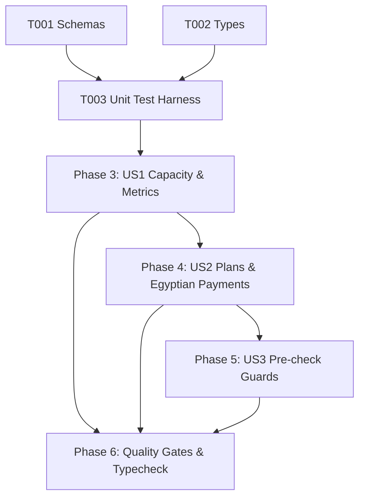

# Tasks: Entitlements and Usage Limits (LMT-001)

**Input**: Design documents from `/specs/007-usage-limits/` (`spec.md`, `plan.md`, `research.md`, `data-model.md`, `contracts/limits-contracts.ts`, `quickstart.md`)

**Prerequisites**: Approved `spec.md` and `plan.md` (Constitutional Gates: 10/10 Passed)

**Organization**: Grouped by prioritized user stories to enable independent implementation and testable increments.

---

## Phase 1: Setup & Shared Utilities

**Purpose**: Shared validation logic and interface contracts

- [x] T001 [P] Verify `UsageMetricsSchema` and `UpgradeWhatsAppRequestSchema` in `src/shared/schemas.ts`.
- [x] T002 [P] Verify `PlanTierConfig`, `PaymentChannel`, `UsageMetrics`, and `UpgradeWhatsAppRequest` in `src/shared/types.ts`.

---

## Phase 2: Foundational Test Harness

**Purpose**: Automated test suite for capacity math, threshold warnings, payment channels, and WhatsApp URL generation

- [x] T003 [P] Create unit test suite in `tests/unit/usage-limits.test.ts` (testing capacity calculations, limit reached thresholds, Egyptian payment channels catalog, and WhatsApp URL generator).

**Checkpoint**: Validation schemas and unit test harness ready.

---

## Phase 3: User Story 1 - Plan & Quota Visibility (Priority: P1) 🎯 MVP

**Goal**: Enable merchants to track product and category capacity against their allotted Free tier limits.

**Independent Test**: Calculate capacity for various product/category counts and verify exact percentages, limit booleans, and Arabic plan labels.

- [x] T004 [US1] Implement `LimitsService.calculateCapacity` pure in-memory calculation in `src/server/services/limits.ts`.
- [x] T005 [US1] Implement `LimitsService.getUsageMetrics` querying active products, categories, and business limits in `src/server/services/limits.ts`.

**Checkpoint**: Quota tracking and capacity calculation operational.

---

## Phase 4: User Story 2 - Subscription Upgrade & Payment Methods Display (Priority: P1) 🎯 MVP

**Goal**: Display subscription plans (Free/Pro), Egyptian payment channels (InstaPay, Vodafone Cash, Bank, Cards Coming Soon), and generate manual upgrade WhatsApp requests.

**Independent Test**: Fetch payment channels to confirm all 4 Egyptian channels exist, and generate a WhatsApp upgrade link with properly encoded Arabic parameters.

- [x] T006 [US2] Implement `LimitsService.getPlanTiers` returning Free and Pro tiers in `src/server/services/limits.ts`.
- [x] T007 [US2] Implement `LimitsService.getAcceptedPaymentChannels` returning InstaPay, Vodafone Cash, Bank Transfer, and Cards (Coming Soon) in `src/server/services/limits.ts`.
- [x] T008 [US2] Implement `LimitsService.generateWhatsAppUpgradeUrl` with encoded Arabic request text in `src/server/services/limits.ts`.

**Checkpoint**: Egyptian payment channels and WhatsApp upgrade generator operational.

---

## Phase 5: User Story 3 - Pre-check Guards (Priority: P2)

**Goal**: Provide fast pre-flight check whether a merchant has remaining capacity before initiating forms.

**Independent Test**: Call `canCreateProduct` and `canCreateCategory` on a business at limit and verify rejection with Arabic explanation.

- [x] T009 [US3] Implement `LimitsService.canCreateProduct` in `src/server/services/limits.ts`.
- [x] T010 [US3] Implement `LimitsService.canCreateCategory` in `src/server/services/limits.ts`.

**Checkpoint**: Fast pre-flight limit guards operational.

---

## Phase 6: Polish, Automated Verification & Quality Gates

**Purpose**: Cross-cutting verification, type safety, and end-to-end testing

- [x] T011 Run automated unit test suite (`node --test tests/unit/*.test.ts`) covering all 8 test suites.
- [x] T012 Execute strict TypeScript typecheck (`npx tsc --noEmit`) and resolve any warnings.
- [x] T013 Verify compliance with all acceptance scenarios in `specs/007-usage-limits/quickstart.md`.

---

## Dependencies & Execution Order

