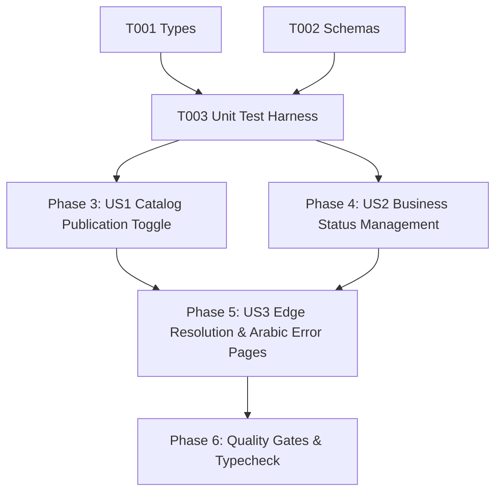

# Tasks: Store and Catalog Lifecycle (LIF-001)

**Input**: Design documents from `/specs/008-store-lifecycle/` (`spec.md`, `plan.md`, `research.md`, `data-model.md`, `contracts/lifecycle-contracts.ts`, `quickstart.md`)

**Prerequisites**: Approved `spec.md` and `plan.md` (Constitutional Gates: 10/10 Passed)

**Organization**: Grouped by prioritized user stories to enable independent implementation and testable increments.

---

## Phase 1: Setup & Shared Utilities

**Purpose**: Shared types, domain enums, and Zod 4 validation schemas

- [x] T001 [P] Verify `BusinessStatus` and `StoreLifecycleResolution` domain types in `src/shared/types.ts`.
- [x] T002 [P] Verify `ToggleCatalogPublishSchema`, `UpdateBusinessStatusSchema`, and `ResolveStoreAvailabilitySchema` in `src/shared/schemas.ts`.

---

## Phase 2: Foundational Test Harness

**Purpose**: Automated test suite for publication toggling, business operational statuses, resolution matrix, and edge responses

- [x] T003 [P] Create and verify automated unit test suite in `tests/unit/store-lifecycle.test.ts` (testing input schemas, lifecycle state matrix, reserved subdomains, and Arabic edge response headers).

**Checkpoint**: Shared types, validation schemas, and automated test harness ready.

---

## Phase 3: User Story 1 - Catalog Publication Toggle (Priority: P1) 🎯 MVP

**Goal**: Enable merchants to toggle catalog publication (`is_published`) on or off with atomic database persistence and tenant ownership check.

**Independent Test**: Call `lifecycleService.setCatalogPublication` with valid businessId and verify catalog `is_published` toggles atomically while rejecting unowned catalogs.

- [x] T004 [US1] Implement `LifecycleService.setCatalogPublication` in `src/server/services/lifecycle.ts`.

**Checkpoint**: Catalog publication toggle operational and independently testable.

---

## Phase 4: User Story 2 - Business Operational Status Management (Priority: P1)

**Goal**: Enable platform administrators to transition business operational status (`active`, `suspended`, `archived`) with audit reason tracking.

**Independent Test**: Call `lifecycleService.setBusinessStatus` with `suspended` or `archived` and verify status persists to `public.businesses` and freezes public catalog access.

- [x] T005 [US2] Implement `LifecycleService.setBusinessStatus` supporting active, suspended, and archived transitions in `src/server/services/lifecycle.ts`.

**Checkpoint**: Business operational status management operational and independently testable.

---

## Phase 5: User Story 3 - Edge Availability Resolution & Arabic Error Pages (Priority: P1)

**Goal**: Provide deterministic store availability resolution at the edge and serve responsive, branded RTL Arabic status pages with strict no-cache headers.

**Independent Test**: Call `lifecycleService.resolveStoreAvailability` for all 5 lifecycle states (active, unpublished, suspended, archived, reserved, not_found) and verify `renderLifecycleResponse` outputs correct HTTP status codes (200, 403, 404) and `no-cache, no-store, must-revalidate` headers.

- [x] T006 [US3] Implement `LifecycleService.resolveStoreAvailability` evaluating reserved system slugs, business operational status, and catalog publication in `src/server/services/lifecycle.ts`.
- [x] T007 [US3] Implement `LifecycleService.renderLifecycleResponse` mapping lifecycle resolution to `tenantErrorPages` in `src/server/services/lifecycle.ts`.
- [x] T008 [US3] Verify `src/server/tenant/error-pages.ts` serves RTL Cairo typography, zero leaks of internal IDs, and strict `Cache-Control: no-cache, no-store, must-revalidate` for offline stores.

**Checkpoint**: Edge store availability resolution and Arabic status pages operational.

---

## Phase 6: Polish, Automated Verification & Quality Gates

**Purpose**: Cross-cutting verification, type safety, and end-to-end regression testing

- [x] T009 Run automated unit test suite (`node --test tests/unit/store-lifecycle.test.ts`).
- [x] T010 Execute strict TypeScript typecheck (`npx tsc --noEmit`) and resolve any compiler warnings.
- [x] T011 Verify compliance with all acceptance scenarios in `specs/008-store-lifecycle/quickstart.md`.

---

## Dependencies & Execution Order

### Phase Dependencies

- **Setup (Phase 1)**: No dependencies - can start immediately.
- **Foundational (Phase 2)**: Depends on Phase 1 - establishes the test harness.
- **User Stories (Phase 3 - 5)**:
  - User Story 1 (P1): Can start after Phase 2.
  - User Story 2 (P1): Can start after Phase 2.
  - User Story 3 (P1): Integrates US1 and US2 states into edge resolution.
- **Polish (Phase 6)**: Depends on all user stories being complete.

### User Story Dependencies

---

## Parallel Opportunities

- `T001` (Types) and `T002` (Schemas) can be verified in parallel.
- `T004` (US1 Catalog Publication) and `T005` (US2 Business Status) affect distinct database tables (`catalogs` vs `businesses`) and can be implemented in parallel.
- Unit test cases in `tests/unit/store-lifecycle.test.ts` execute in parallel.

---

## Implementation Strategy

### MVP First (User Story 1 Only)
1. Complete Phase 1: Setup (Types & Schemas).
2. Complete Phase 2: Foundational (Unit Test Harness).
3. Complete Phase 3: User Story 1 (Catalog Publication Toggle).
4. **Validate**: Test catalog publication toggle independently.

### Incremental Delivery
1. Add User Story 2 (Business Status Management) → Test admin status transitions.
2. Add User Story 3 (Edge Resolution & Arabic Error Pages) → Test edge routing matrix and cache headers.
3. Complete Phase 6: Polish & Typecheck → Ready for `/speckit-analyze` and `/speckit-implement`.
