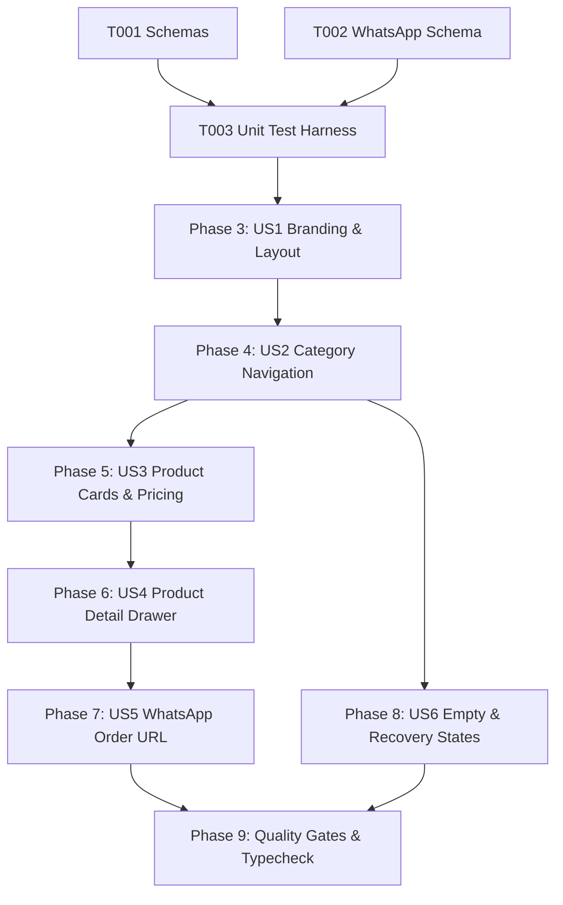

# Tasks: Public Catalog Experience (PUB-001)

**Input**: Design documents from `/specs/009-public-catalog-experience/` (`spec.md`, `plan.md`, `research.md`, `data-model.md`, `contracts/public-catalog-contracts.ts`, `quickstart.md`)

**Prerequisites**: Approved `spec.md` and `plan.md` (Constitutional Gates: 10/10 Passed)

**Organization**: Grouped by prioritized user stories to enable independent implementation and testable increments.

---

## Phase 1: Setup & Shared Utilities

**Purpose**: Shared schemas, DTOs, and interface contracts

- [x] T001 [P] Verify `PublicCatalogPayloadSchema`, `PublicProductSchema`, and `PublicCategorySchema` in `src/shared/schemas.ts`.
- [x] T002 [P] Verify `WhatsAppOrderDetailsSchema` and input types in `src/shared/schemas.ts`.

---

## Phase 2: Foundational Test Harness

**Purpose**: Automated test suite for hydration contracts, WhatsApp message formatting, phone normalization, and dynamic price math

- [x] T003 [P] Create and verify automated unit test suite in `tests/unit/public-catalog.test.ts` (testing catalog hydration validation, WhatsApp order encoding, phone normalization, and dynamic modifier price calculation).

**Checkpoint**: Shared validation schemas and test harness ready.

---

## Phase 3: User Story 1 - Merchant Branding & Storefront Presentation (Priority: P0) 🎯 MVP

**Goal**: Render merchant brand identity (cover banner, logo, Arabic store name, phone) and Web Share API button in mobile-optimized layout.

**Independent Test**: Mount `CatalogHeader` and verify brand assets render with fallback placeholders and native share button works.

- [x] T004 [P] [US1] Implement `CatalogHeader` component with cover banner, logo, and share trigger in `src/public-catalog/components/CatalogHeader.tsx`.
- [x] T005 [US1] Implement mobile-first storefront layout container (`max-w-lg mx-auto`) in `src/routes/_public/c/$catalogSlug.tsx`.

**Checkpoint**: Brand presentation and storefront layout operational.

---

## Phase 4: User Story 2 - Category Navigation & Real-Time Filtering (Priority: P0)

**Goal**: Provide horizontal sticky category pill bar with active selection indicators and product count badges for instant client filtering.

**Independent Test**: Select category pills and verify that product grid filters dynamically with zero network round-trips.

- [x] T006 [US2] Implement sticky horizontal category pill bar with product count badges in `src/public-catalog/components/CategoryPills.tsx`.

**Checkpoint**: Real-time category filtering operational.

---

## Phase 5: User Story 3 - Product Card Presentation & Effective Pricing (Priority: P0)

**Goal**: Display product cards with lazy-loaded cover images, localized names, descriptions, compare-at strikethroughs, and availability badges.

**Independent Test**: Render product cards with various pricing combinations and verify correct effective price and out-of-stock badges.

- [x] T007 [US3] Implement responsive product card with lazy image loading and discount pricing in `src/public-catalog/components/ProductCard.tsx`.

**Checkpoint**: Product card presentation operational.

---

## Phase 6: User Story 4 - Product Detail Drawer & Dynamic Price Calculation (Priority: P0)

**Goal**: Mobile bottom sheet drawer for product details, image gallery, variant selection, and modifier option groups with real-time price accumulation.

**Independent Test**: Open product drawer, toggle variants and modifier options, and verify that total price recalculates dynamically as base + variant delta + modifier sums.

- [x] T008 [US4] Implement mobile bottom sheet drawer with dynamic variant and modifier price calculation in `src/public-catalog/components/ItemDetailDrawer.tsx`.

**Checkpoint**: Product customization drawer and dynamic price math operational.

---

## Phase 7: User Story 5 - Direct WhatsApp Inquiry Formatting (Priority: P0)

**Goal**: Generate structured, URI-encoded Arabic WhatsApp messages targeting cleaned Egyptian mobile numbers.

**Independent Test**: Call `buildWhatsAppOrderUrl` with store, product, variant, and options and verify `wa.me/{phone}?text=...` URI-encoded structure.

- [x] T009 [P] [US5] Implement `buildWhatsAppOrderUrl` with Egyptian phone normalization and Arabic line formatting in `src/public-catalog/utils/whatsapp-formatter.ts`.
- [x] T010 [US5] Implement sticky WhatsApp quick-order bar in `src/public-catalog/components/WhatsAppStickyBar.tsx`.

**Checkpoint**: WhatsApp order link generation and sticky bar operational.

---

## Phase 8: User Story 6 - Empty & Graceful Recovery States (Priority: P1)

**Goal**: Render encouraging Arabic empty states when categories have no active products, with platform viral footer badge.

**Independent Test**: Filter by an empty category and verify Arabic empty message and viral Suez footer badge are displayed.

- [x] T011 [US6] Implement empty state message and viral platform footer branding in `src/routes/_public/c/$catalogSlug.tsx`.

**Checkpoint**: Empty state and footer branding operational.

---

## Phase 9: Polish, Automated Verification & Quality Gates

**Purpose**: Cross-cutting verification, type safety, and end-to-end regression testing

- [x] T012 Run automated unit test suite (`node --test tests/unit/public-catalog.test.ts`).
- [x] T013 Execute strict TypeScript typecheck (`npx tsc --noEmit`) and resolve any compiler warnings.
- [x] T014 Verify compliance with all acceptance scenarios in `specs/009-public-catalog-experience/quickstart.md`.

---

## Dependencies & Execution Order

### Phase Dependencies

- **Setup (Phase 1)**: No dependencies - can start immediately.
- **Foundational (Phase 2)**: Depends on Phase 1 - establishes the test harness.
- **User Stories (Phase 3 - 8)**:
  - User Story 1 (P0): Depends on Phase 2.
  - User Story 2 (P0): Depends on US1 layout.
  - User Story 3 (P0): Depends on US2 category filtering.
  - User Story 4 (P0): Depends on US3 product card interaction.
  - User Story 5 (P0): Integrates with US4 drawer customization.
  - User Story 6 (P1): Depends on US2 and US3 for empty state rendering.
- **Polish (Phase 9)**: Depends on all user stories being complete.

### User Story Dependencies

---

## Parallel Opportunities

- `T001` (Schemas) and `T002` (WhatsApp Schema) can be verified in parallel.
- `T004` (CatalogHeader) and `T009` (whatsapp-formatter) are in separate files and can run in parallel.
- All unit tests in `tests/unit/public-catalog.test.ts` execute in parallel.

---

## Implementation Strategy

### MVP First (User Story 1 & 2 Only)
1. Complete Phase 1: Setup (Schemas & Types).
2. Complete Phase 2: Foundational (Unit Test Harness).
3. Complete Phase 3: User Story 1 (Branding & Layout).
4. Complete Phase 4: User Story 2 (Category Navigation).
5. **Validate**: Test category filtering independently.

### Incremental Delivery
1. Add User Story 3 (Product Cards) → Test price formatting and compare-at discount badges.
2. Add User Story 4 (Product Detail Drawer) → Test dynamic modifier arithmetic.
3. Add User Story 5 (WhatsApp Order URL) → Test Egyptian phone normalization and WhatsApp handoff.
4. Add User Story 6 (Empty States) → Test zero-product category states.
5. Complete Phase 9: Polish & Typecheck → Ready for `/speckit-analyze` and `/speckit-implement`.
