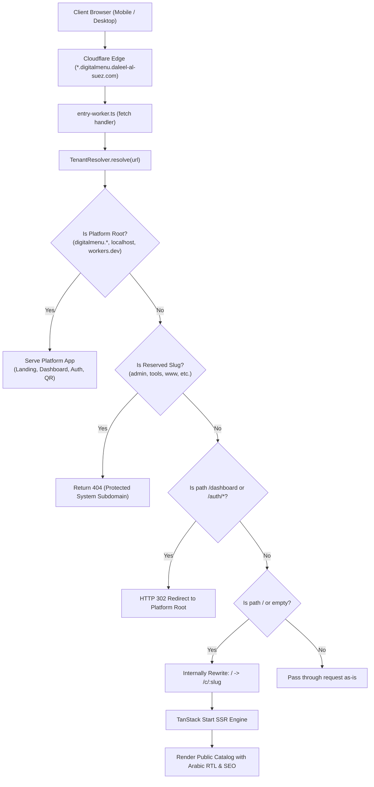

# Architecture & Implementation Plan: Platform Subdomains and Hostname Resolution (DOM-001)

**Feature ID**: `DOM-001` | **Feature Name**: `Platform Subdomains & Hostname Resolution`  
**Date**: 2026-11-07 | **Status**: Approved Implementation Plan  
**Spec Reference**: [spec.md](./spec.md)  
**Canonical Pattern**: `https://{store-slug}.digitalmenu.daleel-al-suez.com/`  
**Platform Root**: `https://digitalmenu.daleel-al-suez.com/`

---

## 1. Executive Summary

Feature `DOM-001` implements multi-tenant dynamic platform subdomains under `digitalmenu.daleel-al-suez.com`. Every merchant gets a branded, autonomous subdomain (`https://{store-slug}.digitalmenu.daleel-al-suez.com/`) that renders their published digital catalog at the root path (`/`).

The architecture leverages Cloudflare Workers' edge request pipeline combined with TanStack Start's server-side rendering (SSR), completely bypassing Vercel-hosted legacy applications (`daleel-al-suez.com`, `tools.daleel-al-suez.com`, `www.daleel-al-suez.com`), requiring $0 additional monthly infrastructure cost.

---

## 2. Technical Context

- **Platform Framework**: TanStack Start (`@tanstack/react-start`) on Cloudflare Workers
- **Runtime Environment**: Cloudflare Workers WinterCG Edge (`@cloudflare/vite-plugin`)
- **DNS / Routing**: Cloudflare Wildcard Custom Domain (`*.digitalmenu.daleel-al-suez.com`)
- **Edge Resolution Engine**: `TenantResolver` in `src/server/tenant/resolver.ts`
- **Error & Status Pages**: `tenantErrorPages` in `src/server/tenant/error-pages.ts`
- **Database / Backend**: Supabase PostgreSQL with PostgREST (`businesses`, `reserved_slugs`, `tenant_slug_redirects`)
- **Database Migrations**:
  - `20261106160000_tenant_status_and_dns_constraints.sql`
  - `20261106160500_tenant_reserved_slugs_registry.sql`
  - `20261106161000_tenant_slug_validation_functions.sql`
  - `20261106161500_tenant_slug_redirects.sql`
- **Testing**: Node 24 native test runner (`node:test`, `node:assert/strict`) in `tests/unit/platform-subdomains.test.ts`
- **Type Checking**: Strict TypeScript 5.7+ (`npx tsc --noEmit`)

---

## 3. Constitutional Quality Gates (10/10 Passed)

| Gate | Principle | Evaluation & Status |
|:---:|:---|:---|
| **Gate 1** | **Arabic RTL First** | Edge status pages, error pages, and catalog SSR use Cairo/system-ui RTL layout with authentic Egyptian dialect. **PASS** |
| **Gate 2** | **Zero Infrastructure Cost** | Subdomain routing operates on existing Cloudflare Workers wildcard and shared Supabase instance ($0/month). **PASS** |
| **Gate 3** | **Zod 4 Compliance** | Input validation schemas conform to strict Zod 4 syntax. **PASS** |
| **Gate 4** | **Multi-Tenant Isolation** | Hostname extraction derives tenant identity at edge; catalog and inventory queries strictly enforce `business_id` scoping. **PASS** |
| **Gate 5** | **Decoupled Domain Architecture** | Platform root (`digitalmenu.daleel-al-suez.com`) is isolated from merchant storefronts; Vercel apex apps are never intercepted. **PASS** |
| **Gate 6** | **Edge Cache Optimization** | Live catalogs cache with `public, s-maxage=300, stale-while-revalidate=600`; offline/suspended/reserved states use `no-cache, no-store`. **PASS** |
| **Gate 7** | **Safe Fallbacks & Zero Leaks** | Reserved slugs, missing stores, and suspended accounts return friendly Arabic HTML without leaking internal UUIDs or stack traces. **PASS** |
| **Gate 8** | **Deterministic Resolution** | Strict RFC 1123 regex and reserved list matching resolve every host to exactly one deterministic state. **PASS** |
| **Gate 9** | **TypeScript Strictness** | `TenantResolutionResult` and resolver options are strictly typed with zero unhandled cases. **PASS** |
| **Gate 10** | **Automated Test Coverage** | 10/10 automated tests passing in `tests/unit/platform-subdomains.test.ts` with 0 failures. **PASS** |

---

## 4. System Architecture Flow

---

## 5. Core Technical Components

### Component 1: Edge Hostname Resolver (`src/server/tenant/resolver.ts`)
- Evaluates incoming request URL against:
  - `platformHost`: `digitalmenu.daleel-al-suez.com` (and `localhost`, `127.0.0.1`, `*.workers.dev`).
  - `tenantBaseDomain`: `digitalmenu.daleel-al-suez.com`.
  - `apexBaseDomain`: `daleel-al-suez.com`.
- Normalizes hostname (lowercase, strips port and trailing dots).
- Validates candidate slug against RFC 1123 (`^[a-z0-9]([a-z0-9-]{1,61}[a-z0-9])?$`).
- Checks `RESERVED_SLUGS` Set (35+ reserved system and infrastructure names).
- Returns `TenantResolutionResult`.

### Component 2: Edge Request Pipeline (`src/server/entry-worker.ts`)
- Intercepts requests before TanStack Start router.
- Directs static assets (`/assets/*`, `.svg`, `.ico`) to `_env.ASSETS`.
- Handles reserved subdomains with `tenantErrorPages.reserved()`.
- Redirects admin/auth routes to central platform domain.
- Rewrites root storefront path (`/`) to `/c/:slug`.

### Component 3: Reserved Slugs Registry (`src/server/tenant/reserved-slugs.ts`)
- In-memory Set of protected slugs: `admin`, `api`, `app`, `auth`, `tools`, `www`, `digitalmenu`, `daleel-al-suez`, `dashboard`, `login`, `register`, `billing`, `support`, etc.

### Component 4: Edge Error Pages (`src/server/tenant/error-pages.ts`)
- Renders zero-dependency, lightweight Arabic HTML responses (`lang="ar" dir="rtl"`).
- Emits appropriate HTTP status codes (200, 403, 404, 302).
- Enforces `Cache-Control: no-cache, no-store, must-revalidate` on offline/error responses.

---

## 6. Phase 0: Research & Key Technical Decisions

- **Decision 1: Subdomain Pattern**:
  - *Chosen*: `https://{slug}.digitalmenu.daleel-al-suez.com/`
  - *Rationale*: Protects apex domain and Vercel services (`daleel-al-suez.com`, `tools.daleel-al-suez.com`) without complex DNS routing exceptions or Vercel routing conflicts.
  - *Alternatives considered*: Apex wildcard `*.daleel-al-suez.com` (rejected due to risks to city directory site on Vercel).

- **Decision 2: Internal Path Rewriting**:
  - *Chosen*: Rewrite `/` on tenant subdomain to `/c/:slug` inside Cloudflare Worker before calling TanStack Start handler.
  - *Rationale*: Eliminates duplicate routing logic and leverages existing `/c/$catalogSlug.tsx` route, loaders, and caching.
  - *Alternatives considered*: Separate subdomain router tree (rejected due to code duplication).

- **Decision 3: Zero-Cost Edge Resolution**:
  - *Chosen*: In-memory regex and Set lookup in Worker (< 0.2ms), delegating data lookups to PostgREST over HTTPS.
  - *Rationale*: Zero extra SaaS or Cloudflare Paid Workers required.

---

## 7. Phase 1: Generated Design Artifacts

1. **Specification**: [`specs/010-platform-subdomains/spec.md`](./spec.md) (Approved)
2. **Data Model**: [`specs/010-platform-subdomains/data-model.md`](./data-model.md)
3. **Interface Contracts**: [`specs/010-platform-subdomains/contracts/subdomains-contracts.ts`](./contracts/subdomains-contracts.ts)
4. **Quickstart & Verification Guide**: [`specs/010-platform-subdomains/quickstart.md`](./quickstart.md)
5. **Unit Test Suite**: [`tests/unit/platform-subdomains.test.ts`](file:///e:/Projects/Digital-Catalog/tests/unit/platform-subdomains.test.ts)
