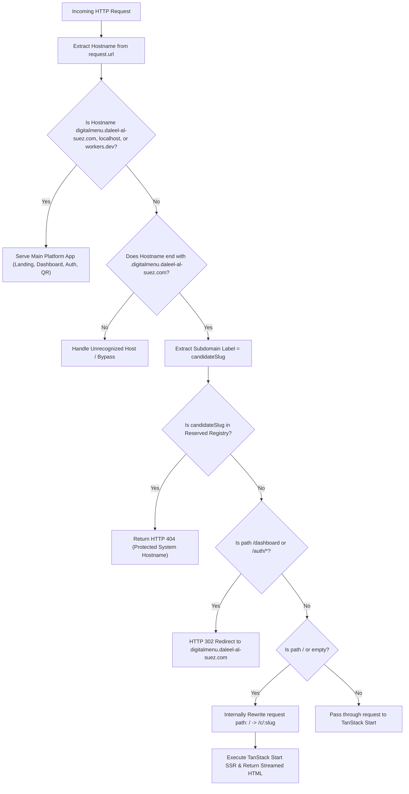

# Feature Specification: Platform Subdomains and Hostname Resolution (DOM-001)

**Feature ID**: `DOM-001` | **Date**: 2026-11-06 | **Status**: Approved Specification  
**Canonical storefront format**: `https://{store-slug}.digitalmenu.daleel-al-suez.com/`  
**Central platform host**: `https://digitalmenu.daleel-al-suez.com/`

---

## 1. Feature Overview & Objective

The **Multi-Tenant Dynamic Subdomains** feature enables every merchant (tenant) on the Digital Catalog platform to have an autonomous, branded digital presence under a dedicated platform subdomain:

```text
https://{store-slug}.digitalmenu.daleel-al-suez.com/
```

Examples:
- `https://ahmed-cafe.digitalmenu.daleel-al-suez.com/`
- `https://sara-fashion.digitalmenu.daleel-al-suez.com/`
- `https://market123.digitalmenu.daleel-al-suez.com/`

When a customer visits a merchant's subdomain, the system resolves the incoming hostname at the Cloudflare Worker edge, verifies the tenant's identity and operational status, and server-side renders (SSR) that merchant's published catalog at the root path (`/`).

This operates as a seamless **multi-tenant architecture**, backed by a single Cloudflare Worker and shared database, without manually provisioning DNS records or individual Cloudflare hostnames per merchant.

---

## 2. Infrastructure Guardrails & Inviolable Boundaries

The project coexists within a shared domain ecosystem (`daleel-al-suez.com`). The following boundaries are **strictly inviolable**:

| Hostname | Host / Service | Purpose | Action in this Feature |
| :--- | :--- | :--- | :--- |
| `daleel-al-suez.com` | Vercel | Main City Directory Website | **NEVER INTERCEPT / PRESERVE ON VERCEL** |
| `www.daleel-al-suez.com` | Vercel | Main Website Alias | **NEVER INTERCEPT / PRESERVE ON VERCEL** |
| `tools.daleel-al-suez.com` | Vercel | Independent Tools Web App | **NEVER INTERCEPT / PRESERVE ON VERCEL** |
| `digitalmenu.daleel-al-suez.com` | Cloudflare Worker (`digital-catalog`) | Platform Landing, Auth, Dashboard, QR Hub | **CONTINUES SERVING CORE PLATFORM** |
| `*.digitalmenu.daleel-al-suez.com` | Cloudflare Worker (`digital-catalog`) | Multi-Tenant Merchant Subdomains | **DYNAMIC MERCHANT STOREFRONTS** |

---

## 3. User Personas & Actors

- **Customer (Diner / Shopper)**: Visits `https://{slug}.digitalmenu.daleel-al-suez.com/` on mobile, browses menu items with images, selects modifiers, and sends WhatsApp orders directly to the merchant.
- **Merchant (Store Owner / Manager)**: Configures a unique, brandable slug during signup, shares their branded subdomain link on social media, prints QR codes pointing to their subdomain, and manages products in the dashboard.
- **Platform Administrator**: Monitors tenant activity, manages the reserved slugs registry, and suspends abusive or fraudulent tenants.
- **Search Engine Crawler (Googlebot)**: Crawls merchant subdomains, indexes published catalog items with structured schema.org data, and respects canonical tags.

---

## 4. User Stories & Acceptance Criteria

### User Story 1: Merchant Chooses Brandable Subdomain (Priority: P1)
> As a **Merchant**,  
> I want to choose a clean, memorable English slug (e.g. `ahmed-cafe`) during store creation,  
> So that my digital menu is accessible at `https://ahmed-cafe.digitalmenu.daleel-al-suez.com/`.

#### Acceptance Criteria:
1. The signup and store creation form validates the slug in real-time against RFC 1123 DNS standards (`^[a-z0-9]([a-z0-9-]{1,61}[a-z0-9])?$`).
2. If the slug matches any entry in `reserved_slugs` (e.g. `admin`, `tools`, `www`, `digitalmenu`), registration is immediately blocked with an Arabic error message explaining that the name is reserved for system use.
3. If the slug is already registered by another tenant (case-insensitive check), registration is blocked with an Arabic error message indicating the name is taken.
4. Upon successful business creation, the merchant's dashboard displays their live subdomain URL (`https://{slug}.digitalmenu.daleel-al-suez.com/`) with a one-click copy button and direct preview link.

---

### User Story 2: Customer Accesses Catalog via Subdomain (Priority: P1)
> As a **Customer**,  
> I want to open `https://ahmed-cafe.digitalmenu.daleel-al-suez.com/` directly on my mobile phone,  
> So that I can immediately view Ahmed Cafe's menu, prices, and order via WhatsApp without entering a nested path.

#### Acceptance Criteria:
1. Visiting `https://{slug}.digitalmenu.daleel-al-suez.com/` displays the merchant's branding (logo, cover, store name, phone) and published catalog at the root path (`/`).
2. Perceived page load time is sub-second (<800ms) on 4G networks via Cloudflare edge SSR.
3. The catalog displays active categories, products, prices in Egyptian Pounds (ج.م / EGP), product images, and the WhatsApp ordering sticky bar.
4. Static assets (CSS stylesheets, JavaScript runtime, SVG icons) load cleanly from `/assets/...` with HTTP 200 and proper MIME types.

---

### User Story 3: Handling Non-Existent or Inactive Tenants (Priority: P1)
> As a **Visitor or Crawler**,  
> When I access an unknown, unpublished, or suspended subdomain (e.g. `unknown-shop.digitalmenu.daleel-al-suez.com`),  
> I want to receive an appropriate HTTP response and helpful Arabic page,  
> So that search engines do not index invalid pages and users know the store is unavailable.

#### Acceptance Criteria:
1. If the subdomain slug does not exist in `businesses`, the edge worker returns an HTTP 404 response with a branded "المتجر غير موجود" page.
2. If the merchant's catalog is unpublished (`is_published = false`), the worker returns an HTTP 403 response with a "هذه القائمة قيد التجهيز حالياً" message.
3. If the merchant account is suspended (`status = 'suspended'`), the worker returns an HTTP 403 response with "هذا الحساب معطل مؤقتاً".
4. Non-existent subdomains NEVER serve the platform's main landing page or another merchant's catalog.

---

### User Story 4: SEO & Canonical Subdomain Links (Priority: P2)
> As a **Merchant and Search Engine**,  
> I want my subdomain catalog to have accurate canonical tags and OpenGraph previews,  
> So that social media shares show rich cards and search engines do not flag duplicate content.

#### Acceptance Criteria:
1. The `<head>` of `https://{slug}.digitalmenu.daleel-al-suez.com/` includes `<link rel="canonical" href="https://{slug}.digitalmenu.daleel-al-suez.com/" />`.
2. OpenGraph `og:url` is set to `https://{slug}.digitalmenu.daleel-al-suez.com/`.
3. OpenGraph `og:title`, `og:description`, and `og:image` reflect the merchant's store name, industry, and cover image.
4. Schema.org JSON-LD contains a `Restaurant` / `Store` structured data object referencing the merchant's subdomain.
5. If accessed via the path `https://digitalmenu.daleel-al-suez.com/c/{slug}`, the canonical link and OpenGraph tags consistently reference `https://{slug}.digitalmenu.daleel-al-suez.com/`.

---

### User Story 5: Dynamic QR Codes Pointing to Subdomain (Priority: P2)
> As a **Merchant**,  
> I want my printable QR codes (`/q/:shortCode`) to seamlessly redirect to my branded subdomain,  
> So that customers scanning table stickers land on my clean URL.

#### Acceptance Criteria:
1. When a QR code is scanned (`https://digitalmenu.daleel-al-suez.com/q/{shortCode}` or `https://{slug}.digitalmenu.daleel-al-suez.com/q/{shortCode}`), it issues an immediate HTTP 302 redirect to `https://{slug}.digitalmenu.daleel-al-suez.com/`.
2. QR scan analytics continue to increment asynchronously without delaying the redirect (<40ms).

---

## 5. Detailed Functional Requirements

### Requirement A: Tenant Slug Management
1. **Slug Format & Validation**:
   - RFC 1123 compliant: `^[a-z0-9]([a-z0-9-]{1,61}[a-z0-9])?$`.
   - Length between 3 and 63 characters inclusive.
   - Lowercase only (automatically converted before validation).
   - No double hyphens (`--`).
   - No Arabic / non-ASCII characters in the subdomain label.
2. **Global Uniqueness**:
   - Database-level unique constraint on `LOWER(slug)` in `businesses`.
3. **Reserved Slugs Registry**:
   - Validation against the `reserved_slugs` database table and in-memory edge cache.
   - Reject reserved infrastructure (`daleel-al-suez`, `www`, `tools`, `digitalmenu`).
   - Reject reserved security and system prefixes (`admin`, `api`, `auth`, `login`, `mail`, `cpanel`, etc.).
4. **Slug Immutability & Modification**:
   - Merchants cannot freely change their slug from the dashboard without administrative validation.
   - If a slug change is executed, the previous slug is archived in `tenant_slug_redirects` to issue HTTP 301 redirects to the new subdomain.

---

### Requirement B: Hostname Resolution Pipeline
The Cloudflare Worker edge handler (`src/server/entry-worker.ts`) executes the following pipeline for every incoming request:



---

### Requirement C: Public Catalog Rendering on Subdomains
1. **Root Path Binding**: When accessing `https://{slug}.digitalmenu.daleel-al-suez.com/`, the root path (`/`) renders the catalog.
2. **Branding & Visuals**: Renders cover image, store avatar/logo, store name, phone number, and industry badge.
3. **Product Hierarchy**: Renders active categories horizontally as sticky filter pills; renders active products with prices, compare-at promotional badges, WebP media thumbnails, and modifier options.
4. **WhatsApp Ordering**: Floating sticky bar opens `https://wa.me/<phone>` with structured Arabic order message.
5. **No Admin Interface Leakage**: If a visitor attempts to access `https://{slug}.digitalmenu.daleel-al-suez.com/dashboard` or `/auth/*`, they are redirected (302) to `https://digitalmenu.daleel-al-suez.com/dashboard`.

---

### Requirement D: Tenant Isolation & Security
1. **Strict Data Scoping**: Every database query for catalog items, categories, products, and media MUST filter by the resolved tenant's `business_id`.
2. **Row Level Security (RLS)**: Public read policies restrict access to rows where `status = 'active'` and `is_published = true`.
3. **Zero Header Spoofing**: Hostname is derived strictly from Cloudflare's validated TLS SNI / HTTP authority pseudo-header. Unverified `X-Forwarded-Host` headers are ignored.
4. **No Service Role Key**: All public catalog resolution is performed using the public anon client. The Service Role Key remains strictly barred.

---

### Requirement E: SEO and Caching Architecture
1. **HTTP Status Codes**:
   - `200 OK`: Valid active tenant with published catalog.
   - `404 Not Found`: Unknown tenant slug or missing catalog.
   - `403 Forbidden`: Suspended tenant or unpublished catalog.
   - `301 Moved Permanently`: Historical slug redirect.
2. **Cloudflare CDN Cache Keys**:
   - Cache key includes full protocol, hostname, and path: `${request.url}`.
   - Edge Cache-Control: `public, s-maxage=300, stale-while-revalidate=600`.
   - Tenant isolation in cache is guaranteed by the distinct hostname.
3. **Cache Invalidation**:
   - When a merchant updates products, prices, or publishing state in the dashboard, the platform triggers a Cloudflare Cache Purge for `https://{slug}.digitalmenu.daleel-al-suez.com/*`.

---

## 6. Edge Cases & Mitigations

| Edge Case | Description | Mitigation Strategy |
| :--- | :--- | :--- |
| **Punycode / IDN Attacks** | Merchant attempts to register Arabic or special chars in DNS | Validation regex strictly enforces `[a-z0-9-]`. Arabic business names are stored in `name`, while `slug` is ASCII-only. |
| **Subdomain Trailing Dots** | Requests sent as `ahmed-cafe.digitalmenu.daleel-al-suez.com.` | Hostname normalizer trims trailing dots and whitespace before resolution. |
| **Port Numbers in Dev** | Host header contains `ahmed-cafe.localhost:5173` | Hostname parser splits on `:` and discards port. |
| **Case Mismatches** | Request sent as `Ahmed-Cafe.DigitalMenu.Daleel-Al-Suez.com` | Hostname is converted to lowercase prior to database query. |
| **Deep Subdomain Nesting** | Request sent as `foo.bar.digitalmenu.daleel-al-suez.com` | Extractor verifies exactly one subdomain label exists before the base domain; reject multi-level subdomains with 404. |
| **Vercel Apps Interception** | Wildcard route accidentally intercepts `tools` or `www` | Apex domain, `tools`, and `www` live directly on `daleel-al-suez.com` and are completely bypassed by routing exclusively under `*.digitalmenu.daleel-al-suez.com`. |
| **Suspended Merchant Access** | Delinquent or abusive merchant | Database status `status = 'suspended'` blocks public rendering with HTTP 403. |
