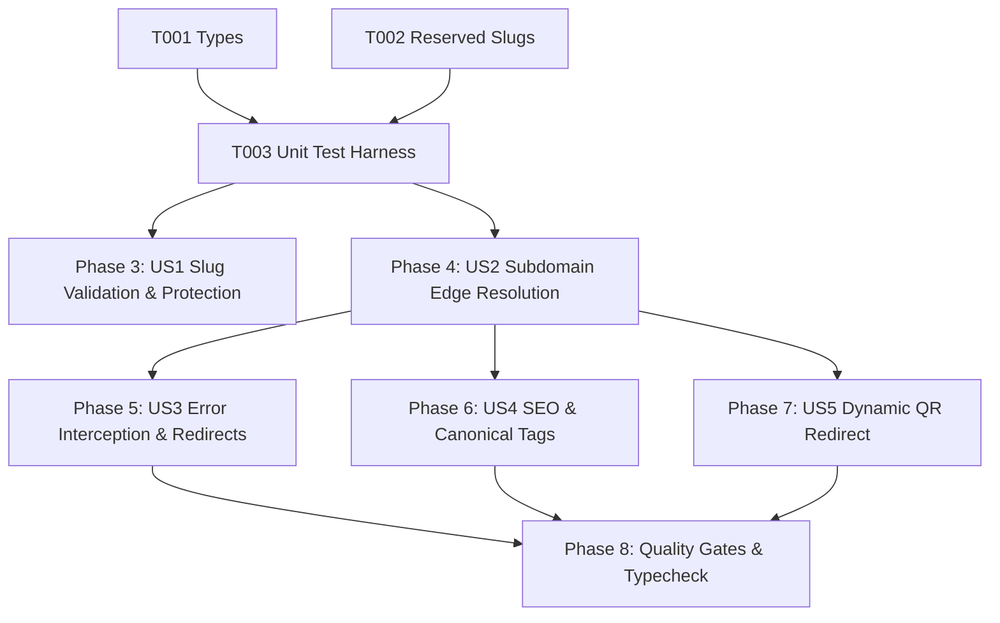

# Tasks: Platform Subdomains and Hostname Resolution (DOM-001)

**Input**: Design documents from `/specs/010-platform-subdomains/` (`spec.md`, `plan.md`, `research.md`, `data-model.md`, `contracts/subdomains-contracts.ts`, `quickstart.md`)

**Prerequisites**: Approved `spec.md` and `plan.md` (Constitutional Gates: 10/10 Passed)

**Organization**: Grouped by prioritized user stories to enable independent implementation and testable increments.

---

## Phase 1: Setup & Shared Utilities

**Purpose**: Shared types, domain contracts, and reserved slug registries

- [x] T001 [P] Verify `TenantResolutionResult` and `SlugValidationResult` in `src/shared/types.ts` and `specs/010-platform-subdomains/contracts/subdomains-contracts.ts`.
- [x] T002 [P] Verify `RESERVED_SLUGS` in `src/server/tenant/reserved-slugs.ts`.

---

## Phase 2: Foundational Test Harness

**Purpose**: Automated test suite for hostname resolution, reserved slugs, port normalization, and edge routing

- [x] T003 [P] Create and verify automated unit test suite in `tests/unit/platform-subdomains.test.ts` (testing platform root, tenant platform subdomains, port normalization, reserved slugs, and RFC 1123 bounds).

**Checkpoint**: Shared types, reserved registries, and automated test harness ready.

---

## Phase 3: User Story 1 - Merchant Chooses Brandable Subdomain (Priority: P1) 🎯 MVP

**Goal**: Enable merchants to choose a memorable, RFC 1123-compliant slug, blocking reserved keywords and duplicate entries.

**Independent Test**: Validate various slugs and verify that reserved ('admin', 'tools'), invalid ('my--shop', 'ab'), and duplicate slugs are rejected with clear Arabic error messages.

- [x] T004 [US1] Verify RFC 1123 validation and reserved slug check in `src/shared/schemas.ts` and `src/server/tenant/reserved-slugs.ts`.
- [x] T005 [US1] Verify database constraints and slug availability RPC in `supabase/migrations/20261106161000_tenant_slug_validation_functions.sql`.

**Checkpoint**: Merchant slug validation and reservation protection operational.

---

## Phase 4: User Story 2 - Customer Accesses Catalog via Subdomain (Priority: P1)

**Goal**: Resolve incoming `{slug}.digitalmenu.daleel-al-suez.com/` requests at edge and rewrite root path `/` to `/c/:slug`.

**Independent Test**: Send simulated request for `https://ahmed-cafe.digitalmenu.daleel-al-suez.com/` and verify `TenantResolver.resolve` returns `isTenantSubdomain: true` with slug `ahmed-cafe` and worker rewrites path to `/c/ahmed-cafe`.

- [x] T006 [US2] Implement and verify `TenantResolver.resolve` supporting `{slug}.digitalmenu.daleel-al-suez.com` in `src/server/tenant/resolver.ts`.
- [x] T007 [US2] Implement internal request path rewrite (`/` -> `/c/:slug`) in `src/server/entry-worker.ts`.

**Checkpoint**: Edge hostname resolution and internal catalog path rewriting operational.

---

## Phase 5: User Story 3 - Handling Non-Existent or Inactive Tenants (Priority: P1)

**Goal**: Intercept reserved hostnames, non-existent stores, and suspended merchants with friendly Arabic HTML error pages.

**Independent Test**: Request `admin.digitalmenu.daleel-al-suez.com` and verify HTTP 404 response with `tenantErrorPages.reserved()`; request `/dashboard` on a tenant subdomain and verify 302 redirect to platform root.

- [x] T008 [US3] Intercept reserved slugs in `src/server/entry-worker.ts` and serve `tenantErrorPages.reserved()`.
- [x] T009 [US3] Redirect `/dashboard` and `/auth/*` on merchant subdomains to central platform in `src/server/entry-worker.ts`.

**Checkpoint**: Edge error interception and admin domain redirection operational.

---

## Phase 6: User Story 4 - SEO & Canonical Subdomain Links (Priority: P2)

**Goal**: Generate canonical link tags, OpenGraph URLs, and structured data targeting the merchant's platform subdomain.

**Independent Test**: Verify `getCanonicalCatalogUrl` formats `https://{slug}.digitalmenu.daleel-al-suez.com` for public catalog head tags.

- [x] T010 [US4] Implement `getCanonicalCatalogUrl` and canonical head metadata in `src/public-catalog/seo/structured-data.ts`.

**Checkpoint**: Subdomain canonical links and SEO metadata operational.

---

## Phase 7: User Story 5 - Dynamic QR Codes Pointing to Subdomain (Priority: P2)

**Goal**: Route `/q/:shortCode` to issue 302 redirects targeting the tenant's branded platform subdomain.

**Independent Test**: Resolve QR short-code and verify 302 Location header targets `https://{slug}.digitalmenu.daleel-al-suez.com/`.

- [x] T011 [US5] Implement QR code destination URL generator targeting `{slug}.digitalmenu.daleel-al-suez.com` in `src/server/routes/q.$shortCode.ts`.

**Checkpoint**: Dynamic QR code redirection to branded subdomain operational.

---

## Phase 8: Polish, Automated Verification & Quality Gates

**Purpose**: Cross-cutting verification, type safety, and end-to-end regression testing

- [x] T012 Run automated unit test suite (`node --test tests/unit/platform-subdomains.test.ts`).
- [x] T013 Execute strict TypeScript typecheck (`npx tsc --noEmit`) and resolve any compiler warnings.
- [x] T014 Verify compliance with all acceptance scenarios in `specs/010-platform-subdomains/quickstart.md`.

---

## Dependencies & Execution Order

### Phase Dependencies

- **Setup (Phase 1)**: No dependencies - can start immediately.
- **Foundational (Phase 2)**: Depends on Phase 1 - establishes the test harness.
- **User Stories (Phase 3 - 7)**:
  - User Story 1 (P1): Can start after Phase 2.
  - User Story 2 (P1): Can start after Phase 2.
  - User Story 3 (P1): Integrates with US2 edge pipeline.
  - User Story 4 (P2): Depends on US2 subdomain resolution.
  - User Story 5 (P2): Depends on US2 subdomain resolution.
- **Polish (Phase 8)**: Depends on all user stories being complete.

### User Story Dependencies

---

## Parallel Opportunities

- `T001` (Types) and `T002` (Reserved Slugs) can be verified in parallel.
- `T004` (Slug validation) and `T006` (TenantResolver) can be verified in parallel.
- All unit test cases in `tests/unit/platform-subdomains.test.ts` execute in parallel.

---

## Implementation Strategy

### MVP First (User Story 1 & 2 Only)
1. Complete Phase 1: Setup (Types & Reserved Registry).
2. Complete Phase 2: Foundational (Unit Test Harness).
3. Complete Phase 3: User Story 1 (Slug Validation).
4. Complete Phase 4: User Story 2 (Subdomain Resolution & Rewrite).
5. **Validate**: Test subdomain extraction and catalog rewrite independently.

### Incremental Delivery
1. Add User Story 3 (Error Interception & Redirects) → Test reserved slug blocking.
2. Add User Story 4 (SEO & Canonical Tags) → Test canonical metadata generation.
3. Add User Story 5 (Dynamic QR Redirects) → Test QR resolution to subdomain.
4. Complete Phase 8: Polish & Typecheck → Ready for `/speckit-analyze` and `/speckit-implement`.
