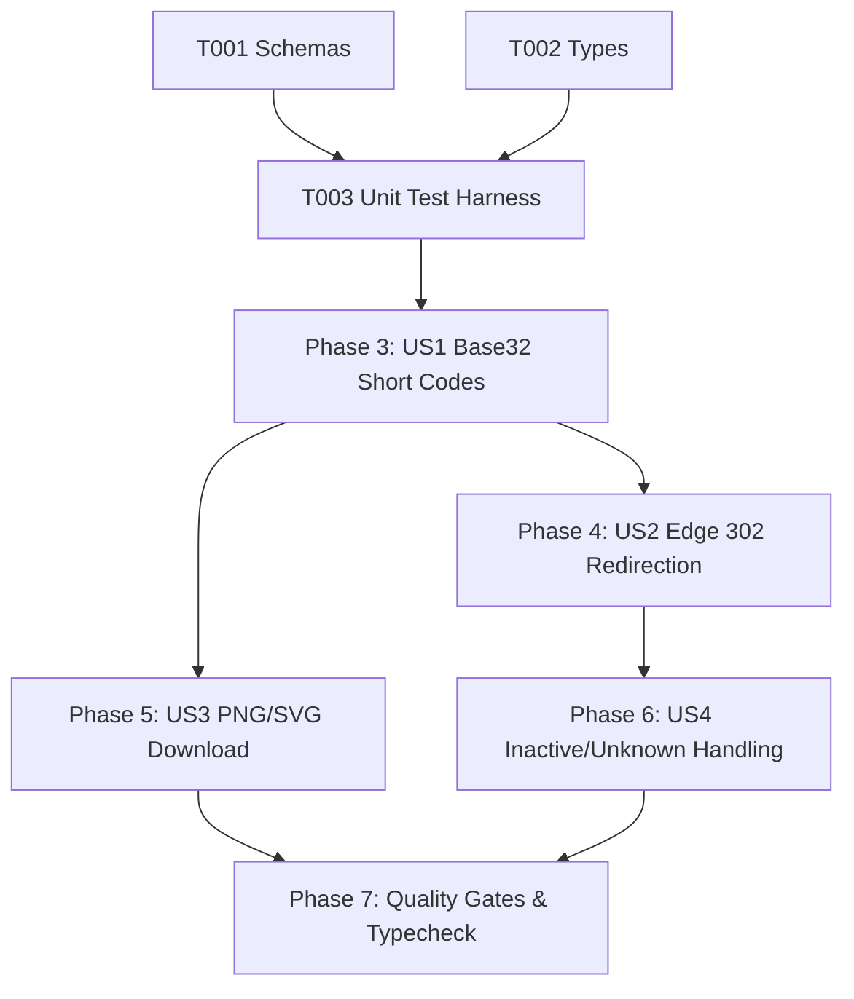

# Tasks: QR Code Management (QR-001)

**Input**: Design documents from `/specs/011-qr-management/` (`spec.md`, `plan.md`, `research.md`, `data-model.md`, `contracts/qr-contracts.ts`, `quickstart.md`)

**Prerequisites**: Approved `spec.md` and `plan.md` (Constitutional Gates: 10/10 Passed)

**Organization**: Grouped by prioritized user stories to enable independent implementation and testable increments.

---

## Phase 1: Setup & Shared Utilities

**Purpose**: Shared validation schemas, DTOs, and interface contracts

- [x] T001 [P] Verify `CreateQRCodeSchema`, `ResolveShortCodeSchema`, and `QRCodeRecordSchema` in `src/shared/schemas.ts`.
- [x] T002 [P] Verify `QRCodeRecord`, `QRDestinationResult`, and `CreateQRCodeParams` in `src/shared/types.ts`.

---

## Phase 2: Foundational Test Harness

**Purpose**: Automated test suite for Base32 short codes, edge 302 redirection, and 404 error handling

- [x] T003 [P] Create and verify automated unit test suite in `tests/unit/qr-management.test.ts` (testing Base32 charset, schema validation, edge 302 redirect headers, and 404 fallback).

**Checkpoint**: Shared validation schemas and test harness ready.

---

## Phase 3: User Story 1 - Stable Base32 Short Code Generation (Priority: P0) 🎯 MVP

**Goal**: Generate unambiguous 6-character Base32 short codes with cryptographic randomness and collision resistance.

**Independent Test**: Call `generateShortCode()` across multiple iterations and verify 6-character length, unambiguous charset (no 0, 1, l, o), and idempotency.

- [x] T004 [US1] Implement `generateShortCode` using unambiguous Base32 charset in `src/server/services/qr.ts`.
- [x] T005 [US1] Implement `QRService.getOrCreateQRCode` with collision handling and database persistence in `src/server/services/qr.ts`.

**Checkpoint**: Cryptographic short code generation and persistence operational.

---

## Phase 4: User Story 2 - Ultra-Fast Edge 302 Redirection (<50ms) (Priority: P0)

**Goal**: Resolve short codes at Cloudflare edge in <50ms with HTTP 302 redirect and strict `no-cache` directives.

**Independent Test**: Call `handleQrRedirect` with active short code and verify HTTP 302 response with Location header pointing to store and `Cache-Control: no-cache, no-store, must-revalidate`.

- [x] T006 [US2] Implement `QRService.resolveDestination` mapping short code to canonical destination URL in `src/server/services/qr.ts`.
- [x] T007 [US2] Implement `handleQrRedirect` with 302 status, Location header, and no-cache policy in `src/server/routes/q.$shortCode.ts`.
- [x] T008 [US2] Integrate edge route interception for `/q/:shortCode` in `src/server/entry-worker.ts`.

**Checkpoint**: Edge 302 redirection pipeline operational.

---

## Phase 5: User Story 3 - High-Resolution Printable PNG/SVG Download (Priority: P0)

**Goal**: Render printable QR code previews and high-resolution PNG/SVG download in merchant dashboard.

**Independent Test**: Mount `QRDownloadModal` and verify QR canvas renders with merchant store name and download triggers for PNG and SVG.

- [x] T009 [US3] Implement QR preview and high-resolution PNG/SVG download modal in `src/client/components/qr/QRDownloadModal.tsx`.

**Checkpoint**: High-resolution QR download modal operational.

---

## Phase 6: User Story 4 - Graceful Handling of Inactive or Unknown QR Codes (Priority: P1)

**Goal**: Return friendly Arabic RTL 404 page when a short code is not found or inactive.

**Independent Test**: Request `/q/nonexistent` and verify HTTP 404 response with Arabic explanation and zero leaks.

- [x] T010 [US4] Implement Arabic fallback 404 response in `src/server/routes/q.$shortCode.ts`.

**Checkpoint**: Inactive / unknown code edge handling operational.

---

## Phase 7: Polish, Automated Verification & Quality Gates

**Purpose**: Cross-cutting verification, type safety, and end-to-end regression testing

- [x] T011 Run automated unit test suite (`node --test tests/unit/qr-management.test.ts`).
- [x] T012 Execute strict TypeScript typecheck (`npx tsc --noEmit`) and resolve any compiler warnings.
- [x] T013 Verify compliance with all acceptance scenarios in `specs/011-qr-management/quickstart.md`.

---

## Dependencies & Execution Order

### Phase Dependencies

- **Setup (Phase 1)**: No dependencies - can start immediately.
- **Foundational (Phase 2)**: Depends on Phase 1 - establishes the test harness.
- **User Stories (Phase 3 - 6)**:
  - User Story 1 (P0): Depends on Phase 2.
  - User Story 2 (P0): Depends on US1 short code generation.
  - User Story 3 (P0): Depends on US1 for QR preview.
  - User Story 4 (P1): Depends on US2 edge redirection.
- **Polish (Phase 7)**: Depends on all user stories being complete.

### User Story Dependencies

---

## Parallel Opportunities

- `T001` (Schemas) and `T002` (Types) can be verified in parallel.
- `T009` (QRDownloadModal) and `T007` (handleQrRedirect) are in separate client/server files and can run in parallel.
- All unit test cases in `tests/unit/qr-management.test.ts` execute in parallel.

---

## Implementation Strategy

### MVP First (User Story 1 & 2 Only)
1. Complete Phase 1: Setup (Schemas & Types).
2. Complete Phase 2: Foundational (Unit Test Harness).
3. Complete Phase 3: User Story 1 (Short Code Generation).
4. Complete Phase 4: User Story 2 (Edge 302 Redirection).
5. **Validate**: Test 302 redirect and cache headers independently.

### Incremental Delivery
1. Add User Story 3 (Printable PNG/SVG Download) → Test download modal.
2. Add User Story 4 (Inactive/Unknown Handling) → Test Arabic 404 response.
3. Complete Phase 7: Polish & Typecheck → Ready for `/speckit-analyze` and `/speckit-implement`.
