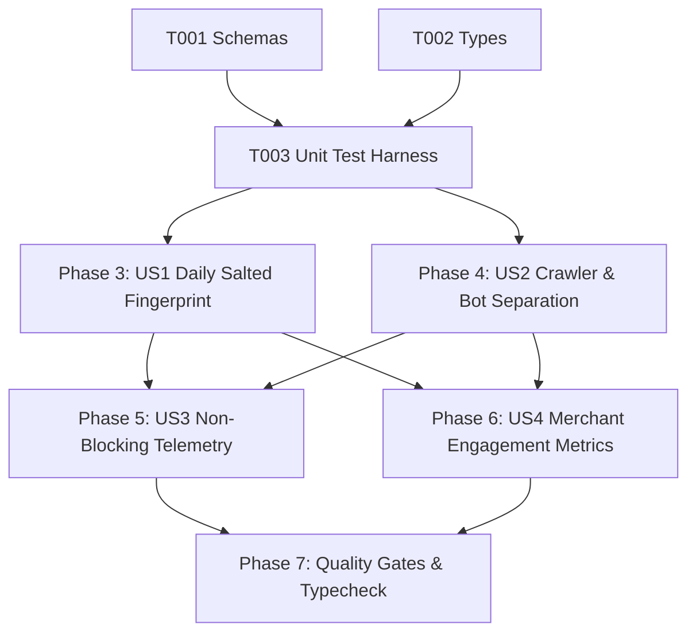

# Tasks: Privacy-Safe Analytics (ANL-001)

**Input**: Design documents from `/specs/012-analytics-privacy/` (`spec.md`, `plan.md`, `research.md`, `data-model.md`, `contracts/analytics-contracts.ts`, `quickstart.md`)

**Prerequisites**: Approved `spec.md` and `plan.md` (Constitutional Gates: 10/10 Passed)

**Organization**: Grouped by prioritized user stories to enable independent implementation and testable increments.

---

## Phase 1: Setup & Shared Utilities

**Purpose**: Shared validation schemas, DTOs, and interface contracts

- [x] T001 [P] Verify `LogQrScanEventSchema`, `AnalyticsSummarySchema`, and `GetBusinessMetricsQuerySchema` in `src/shared/schemas.ts`.
- [x] T002 [P] Verify `AnalyticsSummary` and `LogQrScanEventParams` in `src/shared/types.ts`.

---

## Phase 2: Foundational Test Harness

**Purpose**: Automated test suite for bot filtering, subnet truncation, daily salt divergence, and schema validation

- [x] T003 [P] Create and verify automated unit test harness in `tests/unit/analytics-privacy.test.ts` (testing crawler classification, subnet truncation, SHA-256 daily salt divergence, schema validation, and aggregate calculation).

**Checkpoint**: Shared validation schemas and test harness ready.

---

## Phase 3: User Story 1 - Privacy-Preserving Daily Salted Fingerprinting (Priority: P0) 🎯 MVP

**Goal**: Guarantee zero raw IP storage by truncating IPv4 to /24 and IPv6 to /48 subnets and hashing via SHA-256 with rotating daily salt.

**Independent Test**: Call `generatePrivacyFingerprint()` with IPs across subnets and dates; verify 64-character hex output, subnet equivalence, and cross-day divergence.

- [x] T004 [US1] Implement `truncateIpSubnet` for IPv4 (/24) and IPv6 (/48) in `src/server/services/analytics.ts`.
- [x] T005 [US1] Implement `generatePrivacyFingerprint` using daily rotating salt and SHA-256 in `src/server/services/analytics.ts`.

**Checkpoint**: Privacy-preserving hashing operational.

---

## Phase 4: User Story 2 - Bot & Preview Crawler Separation (Priority: P0)

**Goal**: Classify and separate automated crawlers (WhatsApp, Facebook, Twitter, Googlebot, etc.) from human diners so metrics reflect genuine visits.

**Independent Test**: Call `isCrawlerOrBot()` with known bot User-Agents and mobile browsers; verify bots return true, mobile browsers return false, and empty User-Agent returns true.

- [x] T006 [US2] Implement `isCrawlerOrBot` regex classification and empty User-Agent guard in `src/server/services/analytics.ts`.
- [x] T007 [US2] Implement crawler filtering logic in `logQrScanEvent` to flag `is_bot: true` and skip incrementing `total_scans` in `src/server/services/analytics.ts`.

**Checkpoint**: Bot detection and counter filtering operational.

---

## Phase 5: User Story 3 - Non-Blocking Asynchronous Telemetry (Priority: P0)

**Goal**: Dispatch telemetry events in the background via `ctx.waitUntil` or fire-and-forget promise without delaying customer 302 redirection (<50ms).

**Independent Test**: Trigger scan logging with network latency simulation; verify caller promise resolves immediately without awaiting database write.

- [x] T008 [US3] Implement asynchronous non-blocking event persistence in `src/server/services/analytics.ts` and integration with `ctx.waitUntil` in `src/server/routes/q.$shortCode.ts`.

**Checkpoint**: Non-blocking telemetry pipeline operational.

---

## Phase 6: User Story 4 - Merchant Aggregate Engagement Metrics (Priority: P1)

**Goal**: Calculate tenant-isolated aggregate metrics (`totalScans`, `totalViews`, `totalWhatsAppClicks`, and `uniqueVisitorsEstimate`) for merchant dashboard.

**Independent Test**: Call `AnalyticsService.getBusinessMetrics` with businessId and verify tenant-scoped totals and non-negative metric counts.

- [x] T009 [US4] Implement `AnalyticsService.getBusinessMetrics` with tenant scoping and metric calculation in `src/server/services/analytics-summary.ts`.

**Checkpoint**: Merchant metrics aggregation operational.

---

## Phase 7: Polish, Automated Verification & Quality Gates

**Purpose**: Cross-cutting verification, type safety, and end-to-end regression testing

- [x] T010 Run automated unit test suite (`node --test tests/unit/analytics-privacy.test.ts`).
- [x] T011 Execute strict TypeScript typecheck (`npx tsc --noEmit`) and resolve any compiler warnings.
- [x] T012 Verify compliance with all acceptance scenarios in `specs/012-analytics-privacy/quickstart.md`.

---

## Dependencies & Execution Order

### Phase Dependencies

- **Setup (Phase 1)**: No dependencies - can start immediately.
- **Foundational (Phase 2)**: Depends on Phase 1 - establishes the test harness.
- **User Stories (Phase 3 - 6)**:
  - User Story 1 (P0): Depends on Phase 2.
  - User Story 2 (P0): Depends on Phase 2.
  - User Story 3 (P0): Depends on US1 and US2 for event payload logging.
  - User Story 4 (P1): Depends on US1 and US2 for metric queries.
- **Polish (Phase 7)**: Depends on all user stories being complete.

### User Story Dependencies

---

## Parallel Opportunities

- `T001` (Schemas) and `T002` (Types) can be verified in parallel.
- `US1` (Fingerprinting) and `US2` (Bot Classifier) can run in parallel.
- All unit test cases in `tests/unit/analytics-privacy.test.ts` execute in parallel.

---

## Implementation Strategy

### MVP First (User Story 1 & 2 Only)
1. Complete Phase 1: Setup (Schemas & Types).
2. Complete Phase 2: Foundational (Unit Test Harness).
3. Complete Phase 3: User Story 1 (Daily Salted Fingerprinting).
4. Complete Phase 4: User Story 2 (Bot Separation).
5. **Validate**: Test fingerprinting and crawler detection independently.

### Incremental Delivery
1. Add User Story 3 (Non-Blocking Telemetry) → Test asynchronous dispatch.
2. Add User Story 4 (Merchant Engagement Metrics) → Test metric aggregation.
3. Complete Phase 7: Polish & Typecheck → Ready for `/speckit-analyze` and `/speckit-implement`.
